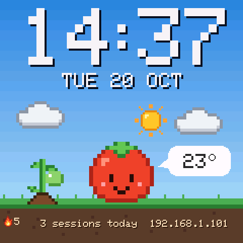

  

<h1 align="center">SmallTV Pomodoro</h1>

  
  
  
  

  
  

**A focus timer for your desk that isn't your phone.** Open-source firmware for the GeekMagic SmallTV Ultra (ESP8266): a Pomodoro timer with a pixel art tomato, clock faces, weather and a web panel. No account, no cloud, no cable to install.

<!-- GIF here: replace docs/hero.gif with a ~6 s GIF cut from the video of the real clock (same file name, ~480 px wide, under 2 MB), and link the video below it. -->

Made from the project's simulator, which compiles the same drawing code as the firmware. A recording of a real clock is coming.

  

  <a href="https://davicorrea0.github.io/smalltv-pomodoro/en/docs.html#primeiros-passos">Install guide</a> ·
  <a href="https://davicorrea0.github.io/smalltv-pomodoro/en/releases.html">Releases</a> ·
  <a href="docs/README.pt.md">Em português</a>

## Why

- **The timer is the point.** A progress ring, the end time and a tomato that reacts: focused while you work, a coffee on the break, asleep when paused, a jump when a phase ends. It keeps a year of daily sessions on the clock, and a plant grows with your streak, up to a golden tomato.
- **Installs without a cable.** You upload it from the clock's own factory web page, like a normal update. Some units need a small loader first ([details](#install)).
- **Updates you can trust.** Network updates are signed (RSA-2048) and the clock checks the whole file before it switches. If something still goes wrong, a **recovery mode with no button** (power-cycle it 3 times) lets you reflash it or go back to the original firmware.
- **Many faces, one small file each.** A dozen faces built in, and 40+ more in the [online gallery](https://davicorrea0.github.io/smalltv-pomodoro/en/gallery.html) that install from the panel without updating the firmware.
- **Made for people, not just tinkerers.** Panel and clock screen in English, Portuguese and Spanish, with layouts for phone and computer. A small [focus game](https://davicorrea0.github.io/smalltv-pomodoro/en/game.html) (streak, garden, achievements, a card of your day) and a photo/GIF album.

## Is this my device?

| Device | Chip | Works? |
|---|---|---|
| **GeekMagic SmallTV Ultra** | ESP8266 | ✅ Yes. This is the device the firmware is made and tested on. |
| GeekMagic SmallTV (original, not Ultra) | ESP8266 | ❔ Not tested. Do not flash it unless you can reflash over serial. |
| GeekMagic SmallTV Pro, other ESP32 / ESP32-C2 clocks | ESP32 | ❌ No. Different chip; do not flash it. |

Not sure? On the Ultra the factory firmware is branded *Ultra* (its web page shows a version like `Ultra-V9.0.x`), and uploading a large firmware there fails with `Not Enough Space` (the loader in step 2 handles that). [smalltv-mod's table](https://github.com/giovi321/smalltv-mod#which-one-do-i-have) has photos of each model.

## Install

You need the clock, a phone or computer on the same Wi-Fi, and a **2.4 GHz** network (the ESP8266 has no 5 GHz).

1. **Download** the latest `.bin` from [Releases](https://github.com/davicorrea0/smalltv-pomodoro/releases/latest).
2. **Upload it** on the clock's factory web page (open the IP shown on its screen) under **Firmware Upgrade**. The clock restarts by itself.
   - Got `ERROR[4]: Not Enough Space`? The factory update space varies between units. First upload the loader [`smalltv-mod-loader.bin`](https://github.com/giovi321/smalltv-mod/releases/tag/v2.8.2) (from giovi321/smalltv-mod v2.8.2), join the open network `SmallTV-Loader` and upload this firmware at `http://192.168.4.1/update`.
     - **The screen goes black with the loader, and that is normal.** The clock is on and waiting for the next step.
     - **Do not unplug it until the Pomodoro screen (the Wi-Fi QR code) appears.** The clock restarts by itself after the upload.
3. **Connect it to Wi-Fi.** If it does not join your network by itself, scan the QR code on its screen with your phone and pick your network. If it does not connect, do not unplug the clock to try again: 3 restarts in a row, each under 30 s, open [recovery mode](#if-something-goes-wrong) (safe, but confusing).
4. **Open the panel** at the IP shown on the screen (or `http://smalltv.local/`). Later updates are one tap in the panel.

> Installing formats the clock's file storage, so photos from the factory firmware are not kept. The saved Wi-Fi stays; settings start from scratch.

The [step-by-step guide](https://davicorrea0.github.io/smalltv-pomodoro/en/docs.html#primeiros-passos) has screenshots, how to find the panel and what to do if something fails.

### If something goes wrong

If the clock freezes or keeps restarting, **unplug it and plug it back in 3 times in a row, leaving it on for less than 30 seconds each time**. It opens **recovery mode**: join the `SmallTV-Recuperacao` network (the password is on the screen) and open `http://192.168.4.1` to upload a firmware, reset the settings or download your focus history. From there you can also go back to [GeekMagic's original firmware](https://github.com/GeekMagicClock/smalltv-ultra) (save a backup in the panel first). If even recovery mode does not open, see [docs/RECUPERACAO.md](docs/RECUPERACAO.md) for a serial reflash.

## Features

- **Pomodoro** with focus, short and long breaks, a daily goal, the activity you are doing (read, study, code, tasks, draw) and the end time on screen.
- **Focus history:** a year of daily sessions, a streak, a garden of the year, 10 achievements and a pixel art card of your day to share.
- **13 built-in faces** (Tomato, Flip, Neon, Retro LCD, Words, Forecast, World and more) and **41 installable** ones. Pick favourites and the clock rotates between them.
- **Weather** from [Open-Meteo](https://open-meteo.com/) with no API key: a 5-day forecast, °C or °F, and a warning when rain starts within the hour (the tomato opens its umbrella).
- **Photos and GIFs**, cropped to 240×240 in the browser.
- **Night brightness** that follows sunset and sunrise, or a fixed schedule.
- **Alexa**, with no account or skill: start, pause and stop the timer by voice on your local network.
- **Panel** with an optional password, backup and restore, diagnostics and test builds for whoever wants them early.

See every face in the [gallery](https://davicorrea0.github.io/smalltv-pomodoro/en/gallery.html), what changed in each [release](https://davicorrea0.github.io/smalltv-pomodoro/en/releases.html), and how to use it all in the [docs](https://davicorrea0.github.io/smalltv-pomodoro/en/docs.html). The full list and the technical details are in [docs/TECHNICAL.md](docs/TECHNICAL.md).

## Related projects

- **[smalltv-mod](https://github.com/giovi321/smalltv-mod)** by giovi321 is a partner project for the same family of clocks: stock and crypto tickers, Home Assistant screens, themes with a visual editor, and support for five models. Its loader is what makes our install work on some units, and the two projects are working on a [shared face format](https://github.com/giovi321/smalltv-mod/issues/31).

## FAQ

**Can I go back to the original firmware?** Recovery mode accepts any firmware, including GeekMagic's `.bin`. Your photos and focus history stay behind, so save a backup in the panel first. Since the 1.24 memory layout, this way back has not been tested on a real clock yet.

**Does it need the internet or an account?** No account. With internet it gets the time, the weather (Open-Meteo) and updates from this project's website. The timer and the faces work offline once the time is set, as long as the clock stays plugged in.

**Will the photos on my clock survive the install?** No: installing formats the file storage. The saved Wi-Fi stays; settings start from scratch. Upload your photos again from the panel.

**Is it safe?** The clock checks every update (size, CRC, full decompression and the project's signature) before it switches, and the current firmware keeps running if anything fails. Flashing any third-party firmware is still at your own risk.

**Where do I report a problem?** In [Issues](https://github.com/davicorrea0/smalltv-pomodoro/issues), in English or Portuguese. The *Diagnostics* card in the panel (why it last restarted, memory, Wi-Fi signal) helps a lot.

## Contributing

Bug reports, ideas and "it works on my unit" reports are welcome in [Issues](https://github.com/davicorrea0/smalltv-pomodoro/issues).

- **New face without compiling:** a small `.json` package, see [docs/PACOTES.md](docs/PACOTES.md) (in Portuguese) and the [`faces/`](faces) folder.
- **Built-in face or code:** the [simulator](docs/TECHNICAL.md#screen-simulator) renders every screen on your PC without flashing; how to build and test is in [docs/TECHNICAL.md](docs/TECHNICAL.md#building).
- **Pixel art:** each sprite is a text file in [`assets/`](assets) ([how](docs/TECHNICAL.md#asset-library)).

Small pull requests, one topic each, are easiest to review. Every firmware change runs the simulator and the build on GitHub Actions.

⭐ If you like it, a star helps other owners of this clock find the project.

## Credits

- Pinout: [ESPHome devices: GeekMagic Ultra](https://devices.esphome.io/devices/geekmagic-ultra/)
- Panel colour order and the loader for the space error: [giovi321/smalltv-mod](https://github.com/giovi321/smalltv-mod)
- Ideas for recovery mode, update checks, backup and flash savings: [michaeldale/smartclock-oss](https://github.com/michaeldale/smartclock-oss) (reimplemented; no code copied)
- LCD face digits: [DSEG7 Classic](https://github.com/keshikan/DSEG) (keshikan, SIL Open Font License 1.1, see `licenses/DSEG-LICENSE.txt`); the segment outlines were extracted from the font and are drawn as polygons
- Flip face digits: [Bebas Neue](https://github.com/dharmatype/Bebas-Neue) (Dharma Type, SIL Open Font License 1.1, see `licenses/BebasNeue-OFL.txt`), also converted to polygons
- `outfit` and `righteous` package fonts: [Outfit](https://github.com/Outfitio/Outfit-Fonts) (The Outfit Project Authors) and [Righteous](https://fonts.google.com/specimen/Righteous) (Astigmatic), SIL Open Font License 1.1, see `licenses/`; digit outlines generated by `sim/fontgen.js`
- [uzlib](https://github.com/pfalcon/uzlib) (Paul Sokolovsky, zlib license, see `licenses/uzlib-LICENSE.txt`), the decompressor from the ESP8266 core, used to check compressed updates
- [JPEGDEC](https://github.com/bitbank2/JPEGDEC) 1.8.4 (BitBank Software, Apache License 2.0, see `licenses/JPEGDEC-LICENSE.txt`), included in `smalltv-pomodoro/src/JPEGDEC` with one change: its color and range lookup tables (7.7 KB) are computed at the start of each decode and freed at the end instead of living in RAM all the time
- [AnimatedGIF](https://github.com/bitbank2/AnimatedGIF) 2.2.3 (BitBank Software, Apache License 2.0, see `licenses/AnimatedGIF-LICENSE.txt`), included in `smalltv-pomodoro/src/AnimatedGIF` with a checked sequential parser and bounds checks in the standard LZW decoder; `gif.inl` is named `gif_inl.h` for Arduino builds. This firmware uses RAW scanline callbacks, without Turbo or a framebuffer.
- Libraries: Adafruit GFX and ST7789, ArduinoJson

GeekMagic and SmallTV are trademarks of their owners. This is an independent project, not affiliated with GeekMagic.

## License

[GNU GPL v3](LICENSE) (GPL-3.0-or-later): you can use, study, change and share the code, the pixel art and the clock faces. If you distribute a modified version, or a firmware built from it, it must also be released under the GPL with its source code.

Third-party parts keep their own licenses (copies in [`licenses/`](licenses)):

- The digit outlines derived from DSEG7, Bebas Neue, Outfit and Righteous (in `smalltv-pomodoro/fonts.cpp` and the faces that use them) remain under the SIL Open Font License 1.1.
- uzlib (`smalltv-pomodoro/src/uzlib/`) is under the zlib license.
- QR generation uses [Project Nayuki's QR Code generator 1.8.0](https://github.com/nayuki/QR-Code-generator/tree/v1.8.0/c), under the MIT license (`licenses/qrcodegen-MIT.txt`).
- JPEGDEC (`smalltv-pomodoro/src/JPEGDEC/`) is under the Apache License 2.0.
- AnimatedGIF (`smalltv-pomodoro/src/AnimatedGIF/`) is under the Apache License 2.0. Local changes are described in `docs/GIF-SECURITY.md`.
