# SmallTV Pomodoro 🍅

Alternative firmware for the **GeekMagic SmallTV Ultra** (ESP8266, 240×240 ST7789 screen): a clock with 11 faces, a Pomodoro timer, weather, a photo/GIF album and a pixel art tomato mascot that grows a plant as you keep your focus streak.

🌐 **Project website:** [davicorrea0.github.io/smalltv-pomodoro](https://davicorrea0.github.io/smalltv-pomodoro/): what changes on the clock, how to install it, and the [face gallery](https://davicorrea0.github.io/smalltv-pomodoro/galeria.html).

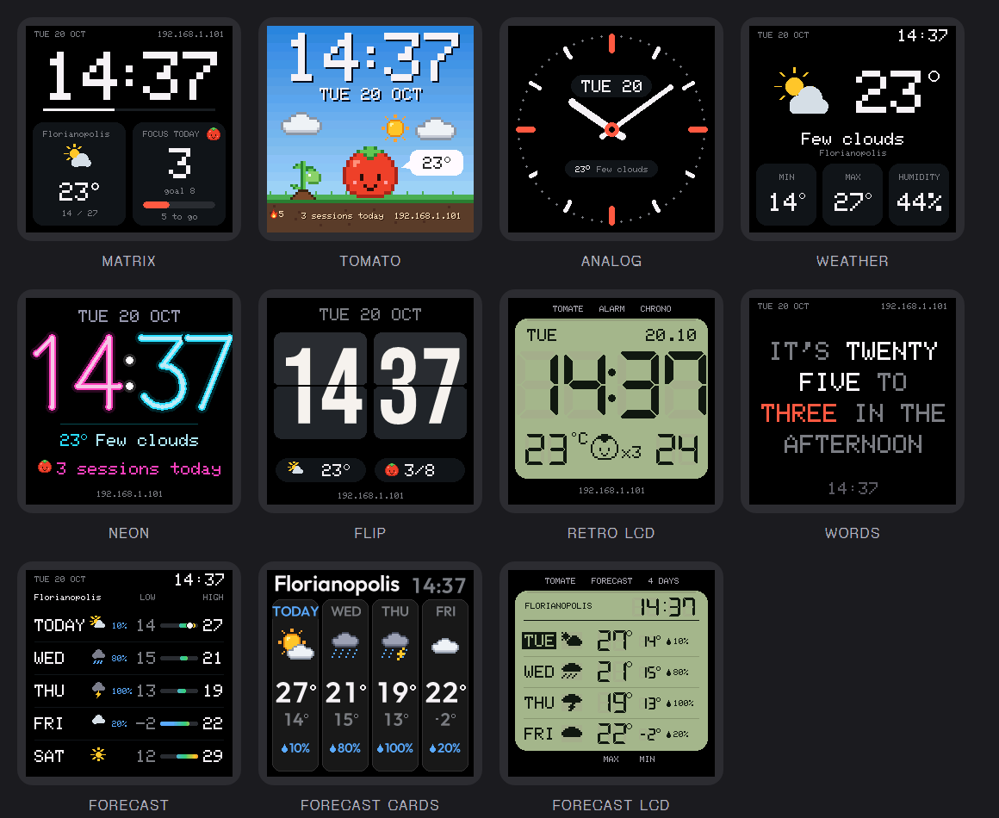

<sub>Screens are rendered by the project's simulator, which compiles the same drawing code as the firmware.</sub>

## Features

- **11 clock faces:** Matrix, Tomato (a pixel art scene that changes with the time and weather: the tomato opens an umbrella in the rain, wears a scarf in the cold and sunglasses in the heat, and cheers when you hit your daily goal), Analog, Weather, Neon, Flip (with a real flip animation), Retro LCD, Words (the time spelled out in English, Portuguese or Spanish), Forecast (today and the next 4 days, with the chance of rain and a low-to-high bar on a shared scale), Forecast cards (four days as cards with a big high, the low and the chance of rain, in the Outfit font with pixel art weather), and Forecast LCD (four days on the Retro LCD screen, with DSEG7 digits and wristwatch-style pictograms).
- **Pomodoro** with a progress ring, the end time, and the tomato changing expression (focused, relaxing with a coffee, asleep when paused). Pick what you will do while focusing (read, study, code, tasks or draw) and the screen shows that activity next to the tomato, which jumps for joy when a phase ends. A daily session counter with a goal.
- **Streak and achievements:** the clock keeps a year of daily focus sessions. A plant next to the tomato grows with every day in a row you hit your goal, up to a golden tomato at 7 days, and a flame shows your streak. In the web panel: a garden of the whole year, 10 achievements, and a pixel art card of your day to share (on a phone it opens the share menu).
- **Downloadable faces:** small `.json` packages installed from the panel without updating the firmware. 36 faces in the online gallery, including Apple Watch and Mi Band inspired ones. A face can carry its text in all three languages and shows the one chosen in the panel.
- **Weather and a 5-day forecast** from [Open-Meteo](https://open-meteo.com/) (no API key), with city search in the panel, in °C or °F.
- **Rain warning:** when rain should start within the next hour, the clock shows "rain 15 min" (and the tomato opens its umbrella), using Open-Meteo's 15-minute precipitation.
- **Automatic time zone:** picking the city also sets the time zone with its daylight saving rules; if the clock's zone does not match the city's, the panel offers to fix it.
- **Diagnostics:** the panel shows why the clock last restarted (with the crash cause and address), the Wi-Fi signal, the lowest free memory since boot and the uptime.
- **Test versions:** an option in the panel to receive test builds before everyone else.
- **Photo and GIF album:** reads the files already saved by the original firmware; uploads from the panel are cropped to 240×240 in the browser.
- **Night brightness** that follows the sun (from sunset to sunrise, using the times Open-Meteo already sends with the weather) or a fixed schedule.
- **Alexa voice control, no account or cloud:** the clock shows up to an Echo on the same network as three dimmable lights (a minimal Philips Hue bridge emulation, the same protocol as Espalexa). *Pomodoro*: "turn on" starts or resumes a focus session and the screen switches to the timer, "turn off" pauses it and, again, stops it, and "set Pomodoro to 40%" focuses for 40 minutes. *Break* and *Long break*: "turn on" starts the break (a percentage sets its minutes), "turn off" goes back to focus. The lit light shows the current phase in the Alexa app, and the web panel shows when an Echo last talked to the clock and its last command. **End-of-phase announcements:** paste a trigger URL from [Virtual Smart Home](https://www.virtualsmarthome.xyz/), Voice Monkey or IFTTT in the panel and the clock calls it when a focus session or a break ends, so an Alexa routine can say "Pomodoro done" (plain HTTP; those services accept it).
- **Face rotation:** pick your favourite faces and the clock switches between them every 1 to 60 minutes.
- **English, Portuguese and Spanish:** the language you choose applies to both the panel and the clock's screen (dates, weather, Pomodoro, the Words face).
- **Web panel** at the IP shown on the screen, with 4 tabs (Clock, Focus, Photos, Settings). It has its own layouts for phones and computers.
- **One-tap updates:** the panel checks the website for new firmware, shows what changed and installs it with one tap.
- **Safe updates:** before switching firmware, the clock checks the file's ESP8266 header, size and the CRC stored in the image, and that it fits. A truncated, corrupted or wrong file is refused and the current firmware keeps running. Since 1.20.1, updates over the network must also carry the project's signature (sent apart from the file, checked before the swap); recovery mode still accepts any firmware, so you can always go back.
- **Protected against other websites:** every action needs a header that only the panel sends (blocks CSRF: a page you visit cannot reset the Wi-Fi, format the storage or flash a firmware), and requests must use the clock's IP address, not a name (blocks DNS rebinding). The Alexa API, the Wi-Fi setup portal and recovery mode stay open on purpose: Alexa can only start and stop the timer, and the other two require being next to the clock.
- **Optional panel password:** the `/update` password (user `admin`) also protects the whole panel and its API; repeated wrong attempts from the same IP wait progressively longer, from 1 to 32 s, without freezing the clock. The setup and recovery Wi-Fi networks use a random 8-character password shown on the clock's screen, and the code the panel loads from the website (share card, translations) is pinned with Subresource Integrity, so a changed file is refused by the browser.
- **Recovery mode without a button:** unplug and plug the clock back in 3 times in a row (or a firmware that crashes right after boot) and it opens its own Wi-Fi network for a password-free update, factory settings, forgetting Wi-Fi or downloading your focus history.
- **Backup and restore** of settings, focus history and downloaded faces in a `.json` file (no passwords or Wi-Fi details).
- **Panel adjustments** for colour order (RGB/BGR), inversion and 180° rotation, with a colour test screen, because these vary between units.

### Tomato scene

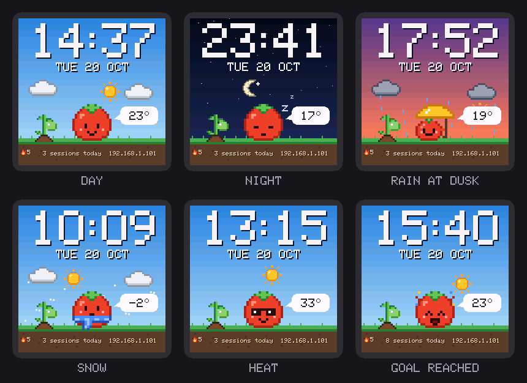

### Streak: the plant grows with every day you hit your goal

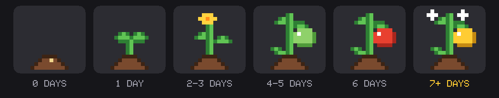

| Share card of your day | Panel on a phone |
|---|---|
| 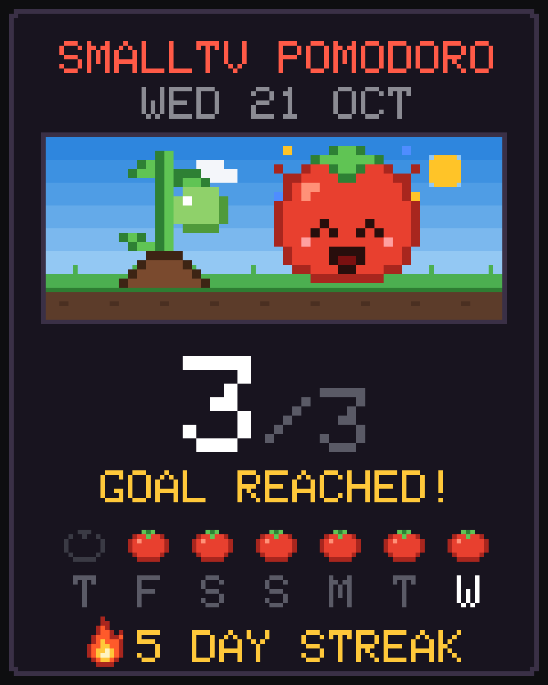 | 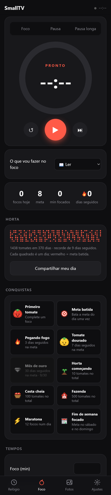 |

### Pomodoro

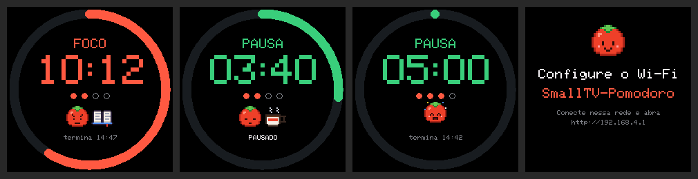

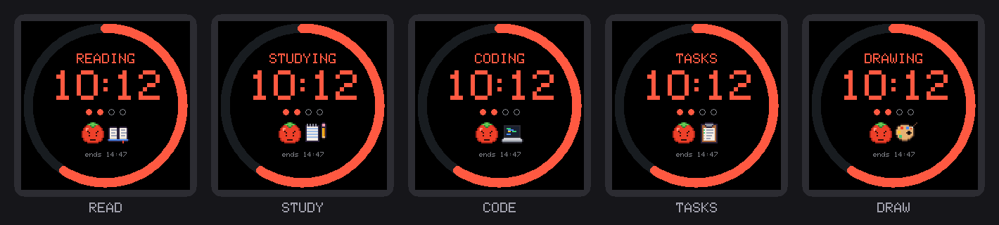

### Flip animation

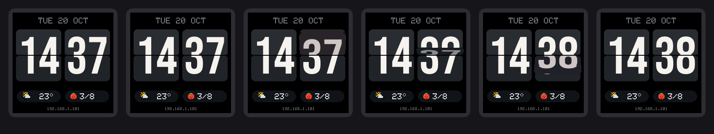

### Three languages

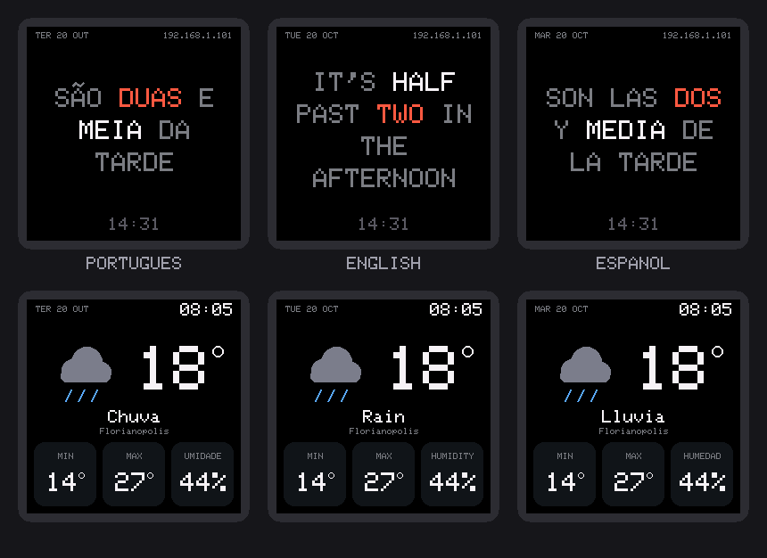

## Web panel

Open the IP shown on the clock in any browser on the same network. Settings save as you change them.

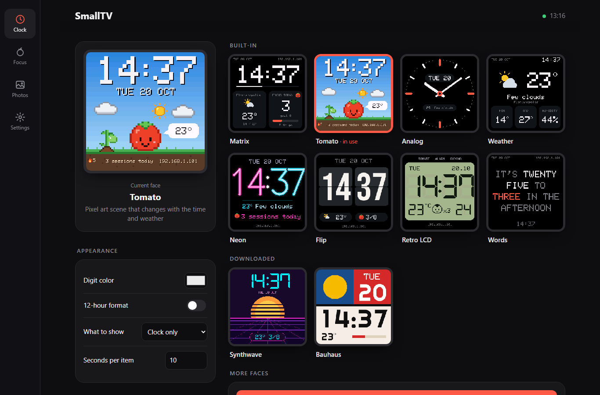

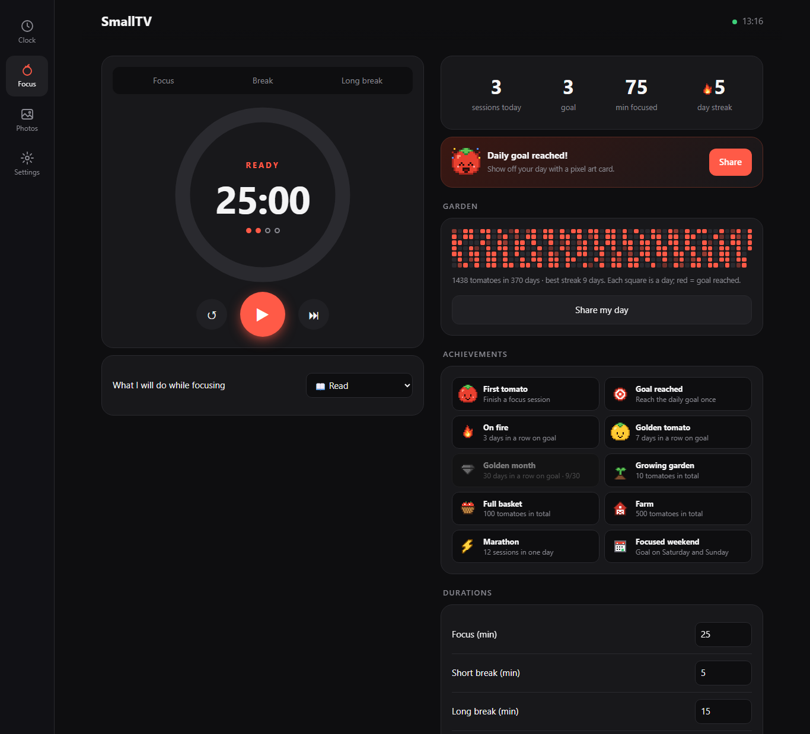

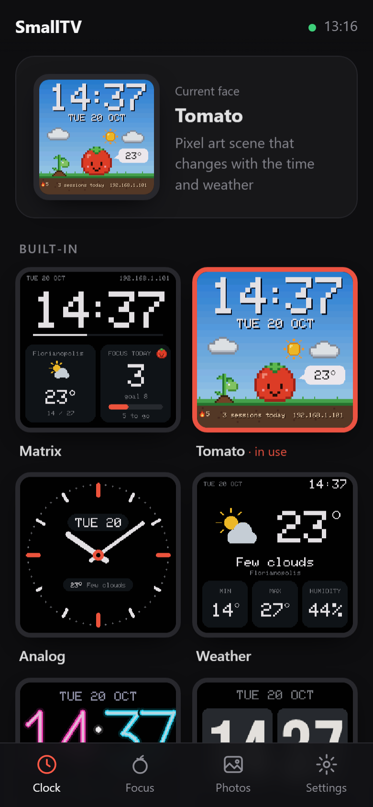

## Install

1. Download the latest `.bin` from [Releases](../../releases).
2. In the original firmware's web page, open **Firmware Upgrade** and upload the file.
   - If you get `ERROR[4]: Not Enough Space`: the factory update space varies between units. First upload the loader [`smalltv-mod-loader.bin`](https://github.com/giovi321/smalltv-mod/releases/tag/v2.8.2) (giovi321/smalltv-mod v2.8.2), join the open network `SmallTV-Loader` and upload this firmware at `http://192.168.4.1/update`.
3. If the clock does not join your network by itself, connect to the `SmallTV-Pomodoro` network and open `http://192.168.4.1` (**2.4 GHz** networks only).
4. Open the IP shown on the screen to use the panel. Later updates: the panel offers them with one tap, or use *Settings → Update firmware*.

### If something goes wrong

If the clock freezes or keeps restarting (for example after an update), **unplug it and plug it back in 3 times in a row, leaving it on for less than 30 seconds each time**. On the third time it opens **recovery mode**: join the `SmallTV-Recuperacao` network and open `http://192.168.4.1` to upload a firmware (no password needed), reset the settings to defaults, forget the Wi-Fi or download your focus history. *Restart normally* goes back to the clock.

To go back to the original firmware, open recovery mode and upload GeekMagic's `.bin` ([GeekMagicClock/smalltv-ultra](https://github.com/GeekMagicClock/smalltv-ultra)) there. Since 1.20.1, *Settings → Update firmware* only accepts firmware signed by this project (with its `.sig` file from the release).

> ⚠️ Only for the **SmallTV Ultra** (ESP8266). Do not flash it on the SmallTV Pro (ESP32) or other models.

## Repository layout

| Folder | Contents |
|---|---|
| `smalltv-pomodoro/` | Firmware (Arduino/ESP8266). `main.cpp`: Wi-Fi, weather, album, Pomodoro, history, updates, recovery and the web server. `ui.cpp` + `ui_kit.h`: the drawing core and kit. `face_*.cpp`: one file per face, registered in `faces_list.h`. `facepack.cpp`: the engine for downloadable faces. `fonts.cpp`: anti-aliased vector fonts. `assets.h` is generated from `assets/` |
| `web/` | Web panel: edit `web/index.html`; `web/build.js` minifies and gzips it into `web/out/panel-<hash>.html.gz` (published on the website) and generates `web.h` with the small loader (`web/loader.html`) and the expected hash |
| `assets/` | Pixel art sprites (one `.txt` per sprite), palettes and the `gerar.js` generator |
| `faces/` | Downloadable face packages (`.json`), their previews and `catalog.json` |
| `sim/` | Screen simulator for the PC, redraw tests, and the face preview and font generators |
| `docs/` | README images and the guides for face packages and built-in faces |

## Asset library

Every pixel art drawing (the tomato and its expressions, the plant stages, the flame, coffee, book, notebook, laptop, clipboard, paint palette, sun, moon, clouds and the end-of-Pomodoro animation) is a text file in `assets/`, one per sprite. `assets/gerar.js` turns them all into `smalltv-pomodoro/assets.h`: each sprite becomes `SPR_<NAME>` in flash (4 bits per pixel, ~130 bytes for a 16×16 sprite), using no RAM.

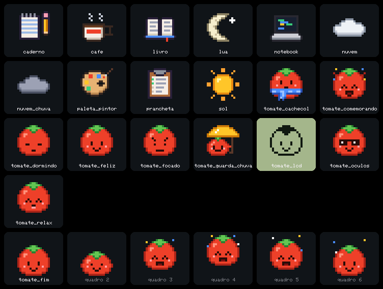

### Adding an asset

1. Create `assets/<name>.txt` (only `a-z`, `0-9` and `_`), for example `assets/regador.txt`:

   ```
   # Watering can: shown when ...
   cor o #2a3a4a   # outline
   cor B #4f8dff   # body
   cor b #9cc0ff   # highlight
   cor A #5aaaff   # water

   ..........A.....
   ...ooooo...A....
   ..oBBbBBo.A.....
   (more rows, until the drawing is complete)
   ```

   - every pixel row has the same length; `.` is transparent;
   - `cor <character> #rrggbb` defines a colour (up to 15 per sprite); `paleta tomate` reuses the colours in `assets/paletas/tomate.txt`;
   - animation: separate frames with a `quadro` line and set each frame's duration with `ms 160`;
   - `fundo #rrggbb` only changes the sprite's background on the preview sheet.

   (The keywords are Portuguese: `cor` = colour, `paleta` = palette, `quadro` = frame, `fundo` = background.)
2. Run `sim/build.sh` (or just `node assets/gerar.js`). Errors point to the file and line.
3. Draw it anywhere in `ui.cpp`:

   ```cpp
   uiSprite(&SPR_REGADOR, x, y);                // scale 1, transparent
   uiSprite(&SPR_REGADOR, x, y, 3, 0, BG);      // scale 3; transparent pixels painted with BG
   uiSprite(&SPR_TOMATE_FIM, x, y, 2, uiSpriteFrame(&SPR_TOMATE_FIM, s.ms), BG);  // animation
   ```

   Passing a background colour repaints the sprite over the previous one without clearing the area first (no flicker).

To change an existing drawing, just edit its `.txt`: no code changes. The sheet above is generated by the simulator in `sim/out/assets.png`.

## Downloadable faces (no firmware update)

Besides the 11 built-in faces, the clock accepts **packages**: `.json` files of a few KB that describe a face in layers (text with variables such as `{HH}:{MM}`, `{TEMP}` and `{STREAK}`, the project's fonts, pixel art sprites, the weather icon, bars, progress rings, dial ticks, hands and the streak plant). Install them from the panel under *Clock → More faces*, from the online gallery or by picking the file. Format and examples (in Portuguese): **[docs/PACOTES.md](docs/PACOTES.md)** and the [`faces/`](faces) folder.

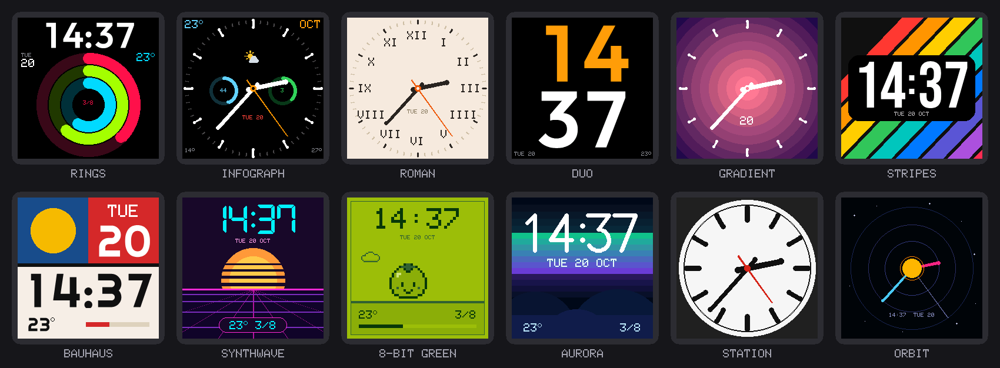

## Creating a built-in face

One `face_<name>.cpp` file and one line in `faces_list.h`: the panel gallery, the preview and the tests follow automatically. Step by step guide, template and what the drawing kit offers (in Portuguese): **[docs/CRIAR_MOSTRADOR.md](docs/CRIAR_MOSTRADOR.md)**.

## Screen simulator

`sim/` compiles the firmware's `ui.cpp`, faces and package engine on the PC (with [Zig](https://ziglang.org/)) and saves each screen as a PNG, plus the asset preview sheet. It also runs a redraw test: it simulates minutes passing, weather changing and sessions being completed, and compares the result with a drawing made from scratch. Any different pixel means something was left behind on the screen. `SIM_LANG=1` (English) or `SIM_LANG=2` (Spanish) renders the screens in another language.

```
sim/build.sh
```

## Building

```
arduino-cli core install esp8266:esp8266 --additional-urls https://arduino.esp8266.com/stable/package_esp8266com_index.json
arduino-cli lib install "Adafruit GFX Library@1.13.0" "Adafruit ST7735 and ST7789 Library@1.11.0" "ArduinoJson@7.4.3"
(cd web && npm install)  # optional: terser minifies the panel (~1 KB smaller)
sim/build.sh   # generates assets.h and web.h, checks the code and tests the screens in the simulator
sim/testes.sh  # Linux/WSL (g++-multilib): upload/host/password handlers, history, GIF and JPEG fuzzing
./compilar.sh  # builds into build/ and checks the size
```

`sim/build.sh` runs on Windows (Zig) and on Linux (Zig, or `g++ -m32` without it). Every push runs all of the above on GitHub Actions (`.github/workflows/firmware.yml`) and keeps the firmware as an artifact.

**Publishing** a version is one command, `scripts/publicar.sh [--beta] [--publicar]`: it checks the tree, scans the diff for secrets, runs the simulator and the tests, builds, adds only new panel files to the website (never overwriting the ones older firmwares point to), writes `firmware/latest.json` (or `firmware/beta.json` with `--beta`), creates the GitHub release and checks the result online. Without `--publicar` it is a dry run that sends nothing. Release notes live in `notas/<version>.json`.

The time zone table (`web/tz.json`, IANA name → POSIX rule) is generated from the system tzdata by `web/tzgen.sh` and published like the dictionary.

The panel's English and Spanish texts live in `web/i18n.json`, not in flash: `web/build.js` writes `web/out/i18n-<code>.json`, which is published in the website's `panel/` folder; the panel downloads it once and keeps it in the browser.

`compilar.sh` builds without newlib's decimal number printf/scanf (`--build-property build.float=`, ~7 KB): the firmware never uses `%f` or parses decimals with it, and `sim/build.sh` rejects code that does.

## Technical details

- **4M3M flash layout**, the same as the original firmware (LittleFS constants found in the V9.0.50 binary at offset `0x14d00`), so existing photos and GIFs are read. LittleFS is mounted **without auto-format**: if it fails to mount, nothing is erased.
- **Compressed updates:** since 1.14 the clock also accepts `.bin.gz` firmware (~74% of the size, made by `compactar.js` with an 8 KB window). The `.gz` is written at the end of the 1 MB program area and the bootloader (eboot) decompresses it over the current firmware on reboot, so a corrupted file would leave the clock without firmware. Before allowing the swap, the clock reads the stored `.gz` back, decompresses all of it with the same uzlib the bootloader uses and checks the gzip CRC, the image header, size and CRC, and that the decompressed image ends before the `.gz`; otherwise it cancels the swap. This lifts the size limit from ~520 KB to ~600 KB (`compilar.sh` checks it). The original GeekMagic firmware can be installed as `.bin` while ours is under ~530 KB, and as `.bin.gz` after that.
- **Update checks:** the elf2bin tool writes the image size and a CRC32 into every ESP8266 Arduino image (offsets 4112 and 4116); all original V9.0.x firmwares have them too. `/update` checks them while the file arrives and only switches firmware if everything matches.
- **Recovery:** a boot counter stored in EEPROM after the settings (it survives power loss, unlike RTC memory). Three boots shorter than 30 s in a row open recovery mode; staying on for 30 s, or a deliberate restart, resets it.
- **Focus history:** one count per day in a 371-day ring (`/stats.bin` on LittleFS, ~380 bytes). Only the header stays in RAM. If a photo, face or panel upload is writing another file, the history write waits until that upload closes, avoiding simultaneous LittleFS writers.
- **Panel in the file storage (1.19+):** the minified, gzipped panel (~70 KB → ~19 KB) lives in LittleFS as `/www/<hash>.gz` instead of the 1 MB program area. Only a ~1 KB loader stays in flash: the first time (or after an update or formatting the storage) it downloads this version's panel from the website with Subresource Integrity, hands it to the clock, which checks the SHA-256 again and only ever serves the file whose hash matches the one compiled into the firmware. The in-panel update also pre-installs the next version's panel. The network stack uses the light lwIP variant (`ip=lm2n`, without features the clock does not use, such as PPP and routing).
- **Fonts drawn by code:** the digits (5×7 pixel art, the "Geo" vector font, the DSEG7 segments, and Bebas Neue, Outfit and Righteous outlines) are polygons rather than bitmaps.
- **Sprites** in `PROGMEM` at 4 bits per pixel, drawn by merging neighbouring pixels of the same colour into rectangles (fewer SPI calls).
- **Translated text in flash:** `tr("pt", "en", "es")` keeps the three strings in flash with `PSTR` and copies only the current language into a small buffer, leaving the RAM the GIF decoder needs.
- **RAM:** the GIF decoder needs ~24 KB of contiguous memory and the JPEG decoder ~18 KB. If memory runs short, the screen shows a notice instead of crashing.
- **Network name (1.20.1):** the clock answers `http://smalltv-xxxx.local` (4 hex digits from the chip, shown on screen at startup) with a minimal mDNS responder that only serves its own A record (~1.7 KB instead of ~21 KB for the core library; packet parser tested with malformed and looping packets in `sim/security_test.cjs`). The web server accepts that exact name besides IPv4 addresses, so DNS rebinding stays blocked.
- **Signed updates (1.20.1):** RSA-2048 over the SHA-256 of the uploaded `.bin`/`.bin.gz`, sent in the `X-Firmware-Sig` header and checked with BearSSL before `Update.end(true)` (~6.5 KB of firmware). The signature is never appended to the image: the 1.20.0 test build did that and the bootloader read the trailer as the image size. See [docs/ASSINATURAS.md](docs/ASSINATURAS.md).
- **GIF validation:** uploads and existing album files are checked before decoding (complete blocks, palettes, frame bounds, up to 480×480 and 2,000 frames). The bundled decoder uses checked reads and bounds LZW codes, dictionary links and compressed input. See [the GIF hardening notes](docs/GIF-SECURITY.md) for test coverage and limits.
- **Wi-Fi downgrade guard:** the ESP8266 SDK can be pushed by a forged beacon to drop to an unencrypted (open) connection with a rogue access point ([CVE-2020-12638](https://nvd.nist.gov/vuln/detail/CVE-2020-12638), not fixed by Espressif for this SDK). Since 1.18.2 the clock watches the Wi-Fi authentication mode and reconnects as soon as it gets weaker, and a saved network (including one set up by the original firmware) only accepts WPA or better. The SDK in use (2.2.1+100, 2019-07-03) already includes Espressif's fix for the beacon crash (CVE-2019-12588). FragAttacks have no fix for this SDK: keep the panel password on and, if your router allows it, put the clock on a guest/IoT network. [docs/FRAGATTACKS-TESTE.md](docs/FRAGATTACKS-TESTE.md) (in Portuguese) shows how to measure which of them affect your clock with the researcher's test tool.
- **Protected clock time (1.19.1):** the SNTP client in the ESP8266 core accepts any reply, so one injected UDP packet could change the time and wipe the focus history. The time only counts for the history once it matches the local time Open-Meteo sends over TCP (or, without weather, two consecutive syncs that agree); a jump that is not confirmed is undone, and a date in the past never erases anything. Wrong panel passwords make that IP wait 1 s instead of freezing the whole clock, and SSDP answers at most 4 times per second.

### Pinout

| Function | GPIO |
|---|---|
| SPI CLK / MOSI | 14 / 13 |
| Display DC | 0 |
| Display RST | 2 |
| Backlight (inverted PWM) | 5 |

## Credits

- Pinout: [ESPHome devices — GeekMagic Ultra](https://devices.esphome.io/devices/geekmagic-ultra/)
- Panel colour order and the loader for the space error: [giovi321/smalltv-mod](https://github.com/giovi321/smalltv-mod)
- Ideas for recovery mode, update checks, backup and flash savings: [michaeldale/smartclock-oss](https://github.com/michaeldale/smartclock-oss) (reimplemented; no code copied)
- LCD face digits: [DSEG7 Classic](https://github.com/keshikan/DSEG) (keshikan, SIL Open Font License 1.1 — see `licenses/DSEG-LICENSE.txt`); the segment outlines were extracted from the font and are drawn as polygons
- Flip face digits: [Bebas Neue](https://github.com/dharmatype/Bebas-Neue) (Dharma Type, SIL Open Font License 1.1 — see `licenses/BebasNeue-OFL.txt`), also converted to polygons
- `outfit` and `righteous` package fonts: [Outfit](https://github.com/Outfitio/Outfit-Fonts) (The Outfit Project Authors) and [Righteous](https://fonts.google.com/specimen/Righteous) (Astigmatic), SIL Open Font License 1.1 — see `licenses/`; digit outlines generated by `sim/fontgen.js`
- [uzlib](https://github.com/pfalcon/uzlib) (Paul Sokolovsky, zlib license — see `licenses/uzlib-LICENSE.txt`), the decompressor from the ESP8266 core, used to check compressed updates
- [JPEGDEC](https://github.com/bitbank2/JPEGDEC) 1.8.4 (BitBank Software, Apache License 2.0 — see `licenses/JPEGDEC-LICENSE.txt`), included in `smalltv-pomodoro/src/JPEGDEC` with one change: its color and range lookup tables (7.7 KB) are computed at the start of each decode and freed at the end instead of living in RAM all the time
- [AnimatedGIF](https://github.com/bitbank2/AnimatedGIF) 2.2.3 (BitBank Software, Apache License 2.0 — see `licenses/AnimatedGIF-LICENSE.txt`), included in `smalltv-pomodoro/src/AnimatedGIF` with a checked sequential parser and bounds checks in the standard LZW decoder; `gif.inl` is named `gif_inl.h` for Arduino builds. This firmware uses RAW scanline callbacks, without Turbo or a framebuffer.
- Libraries: Adafruit GFX and ST7789, ArduinoJson

## License

[GNU GPL v3](LICENSE) (GPL-3.0-or-later): you can use, study, change and share the code, the pixel art and the clock faces. If you distribute a modified version, or a firmware built from it, it must also be released under the GPL with its source code.

Third-party parts keep their own licenses (copies in [`licenses/`](licenses)):

- The digit outlines derived from DSEG7, Bebas Neue, Outfit and Righteous (in `smalltv-pomodoro/fonts.cpp` and the faces that use them) remain under the SIL Open Font License 1.1.
- uzlib (`smalltv-pomodoro/src/uzlib/`) is under the zlib license.
- JPEGDEC (`smalltv-pomodoro/src/JPEGDEC/`) is under the Apache License 2.0.
- AnimatedGIF (`smalltv-pomodoro/src/AnimatedGIF/`) is under the Apache License 2.0. Local changes are described in `docs/GIF-SECURITY.md`.
