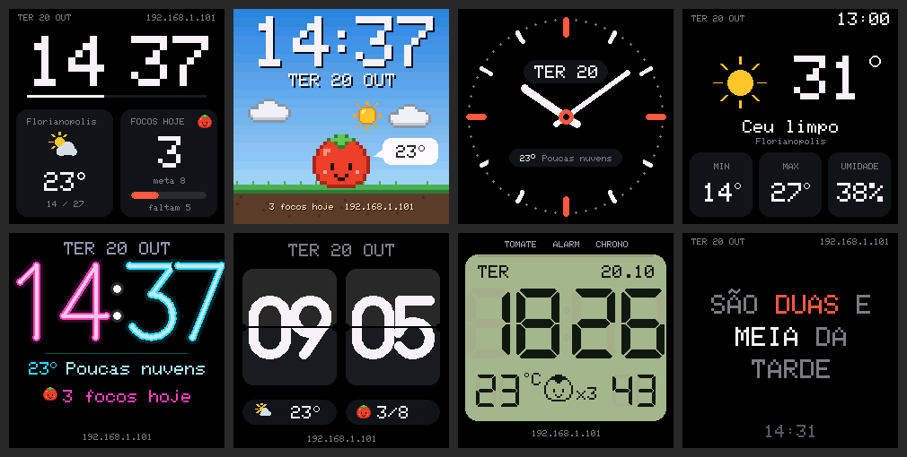
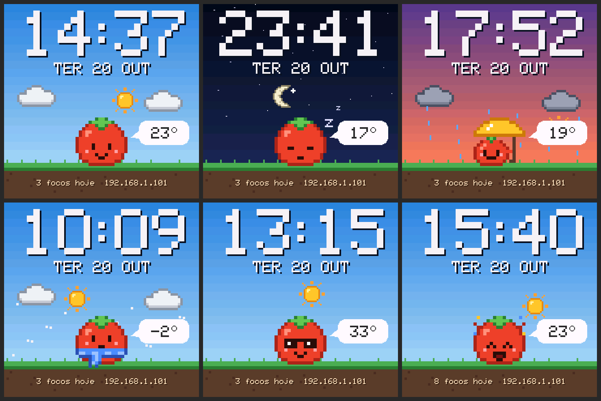
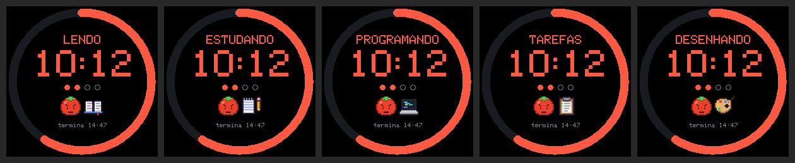
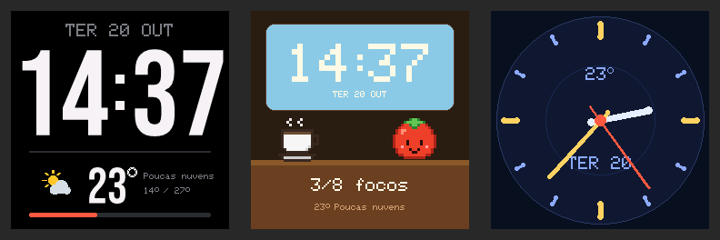

# SmallTV Pomodoro 🍅

Firmware alternativo para o **GeekMagic SmallTV Ultra** (ESP8266, tela ST7789 240×240): relógio com 8 mostradores, Pomodoro, clima, álbum de fotos/GIFs e um mascote tomate em pixel art.

🌐 **Site do projeto:** [davicorrea0.github.io/smalltv-pomodoro](https://davicorrea0.github.io/smalltv-pomodoro/) — o que muda no relógio, como instalar e a [galeria de mostradores](https://davicorrea0.github.io/smalltv-pomodoro/galeria.html).



<sub>Imagens geradas pelo simulador do projeto, que compila o mesmo código de desenho do firmware.</sub>

## Funções

- **8 mostradores**: Matriz, Tomate (cena em pixel art que muda com a hora e o clima; o tomate abre o guarda-chuva na chuva, põe cachecol no frio, óculos escuros no calor e comemora a meta do dia), Analógico, Clima, Neon, Flip (com animação de virada de verdade), LCD retrô e Palavras (hora por extenso em português)
- **Pomodoro** com anel de progresso, horário de término e o tomate mudando de expressão (focado, relaxando com um café, dormindo quando pausado); você escolhe no painel o que vai fazer no foco (ler, estudar, programar, tarefas ou desenhar) e a tela mostra a atividade e o objeto dela ao lado do tomate e pulando de alegria quando uma fase termina; contador de focos do dia com meta diária
- **Clima** via [Open-Meteo](https://open-meteo.com/) (sem chave de API), com busca de cidade pelo painel
- **Álbum de fotos e GIFs**: lê os arquivos já gravados pelo firmware original; envio pelo painel com recorte automático para 240×240
- **Brilho noturno** por horário
- **Painel web** no IP mostrado na tela, em 4 abas (Relógio, Foco, Fotos, Ajustes): galeria dos mostradores com prévia ("Ver no relógio" mostra o mostrador por 15 s sem salvar), controle do Pomodoro, fotos e ajustes que salvam sozinhos
- **Ajustes do painel** (ordem de cor RGB/BGR, inversão, rotação 180°) com tela de teste de cores, porque isso varia entre unidades
- **Atualização OTA** em `/update` (usuário `admin`, senha opcional), que também serve para voltar ao firmware original






## Instalar

1. Baixe o `.bin` mais recente em [Releases](../../releases).
2. No painel web do firmware original, abra **Firmware Upgrade** e envie o arquivo.
   - Se aparecer `ERROR[4]: Not Enough Space`: o espaço de atualização de fábrica varia entre unidades. Envie antes o carregador [`smalltv-mod-loader.bin`](https://github.com/giovi321/smalltv-mod/releases/tag/v2.8.2) (giovi321/smalltv-mod v2.8.2), conecte-se à rede aberta `SmallTV-Loader` e envie este firmware em `http://192.168.4.1/update`.
3. Se o relógio não conectar sozinho na sua rede, conecte-se à rede `SmallTV-Pomodoro` e abra `http://192.168.4.1` (só redes **2,4 GHz**).
4. Abra o IP que aparece na tela para usar o painel. Atualizações seguintes: *Sistema → Atualizar firmware*.

Para voltar ao firmware original, envie o `.bin` da GeekMagic ([GeekMagicClock/smalltv-ultra](https://github.com/GeekMagicClock/smalltv-ultra)) em *Sistema → Atualizar firmware*.

> ⚠️ Use só no **SmallTV Ultra** (ESP8266). Não grave no SmallTV Pro (ESP32) nem em outros modelos.

## Estrutura

| Pasta | Conteúdo |
|---|---|
| `smalltv-pomodoro/` | Firmware (Arduino/ESP8266). `main.cpp`: Wi-Fi, clima, álbum, Pomodoro e servidor web. `ui.cpp` + `ui_kit.h`: núcleo e kit de desenho. `face_*.cpp`: um arquivo por mostrador, registrados em `faces_list.h`. `assets.h` é gerado a partir de `assets/` |
| `web/` | Painel web: edite `web/index.html`; `web/build.js` gera o `web.h` comprimido (gzip) |
| `assets/` | Sprites em pixel art (um `.txt` por sprite), paletas e o gerador `gerar.js` |
| `sim/` | Simulador das telas no PC; `sim/faces.js` gera as prévias da galeria (`docs/faces/` e `smalltv-pomodoro/faces.h`) |
| `docs/` | Imagens do README |

## Biblioteca de assets

Todos os desenhos em pixel art (o tomate e suas expressões, café, livro, caderno, notebook, prancheta, paleta de pintor, sol, lua, nuvens e a animação de fim de Pomodoro) são arquivos de texto em `assets/`, um por sprite. O `assets/gerar.js` converte todos em `smalltv-pomodoro/assets.h`: cada sprite vira `SPR_<NOME>` na flash (4 bits por pixel, ~130 bytes um sprite 16×16), sem gastar RAM.


### Adicionar um asset

1. Crie `assets/<nome>.txt` (só `a-z`, `0-9` e `_`), por exemplo `assets/regador.txt`:

   ```
   # Regador: aparece quando ...
   cor o #2a3a4a   # contorno
   cor B #4f8dff   # corpo
   cor b #9cc0ff   # brilho
   cor A #5aaaff   # água

   ..........A.....
   ...ooooo...A....
   ..oBBbBBo.A.....
   (mais linhas, até completar o desenho)
   ```

   - cada linha de pixels tem o mesmo comprimento; `.` é transparente;
   - `cor <caractere> #rrggbb` define as cores (até 15 por sprite); `paleta tomate` reaproveita as cores de `assets/paletas/tomate.txt`;
   - animação: separe os quadros com uma linha `quadro` e diga a duração de cada um com `ms 160`;
   - `fundo #rrggbb` só muda o fundo do sprite na folha de prévia.
2. Rode `sim/build.sh` (ou só `node assets/gerar.js`). Erros apontam arquivo e linha.
3. Desenhe onde quiser em `ui.cpp`:

   ```cpp
   uiSprite(&SPR_REGADOR, x, y);                // escala 1, transparente
   uiSprite(&SPR_REGADOR, x, y, 3, 0, BG);      // escala 3; transparente pintado com BG
   uiSprite(&SPR_TOMATE_FIM, x, y, 2, uiSpriteFrame(&SPR_TOMATE_FIM, s.ms), BG);  // animação
   ```

   Passar a cor de fundo repinta o sprite por cima do anterior sem limpar a área antes (sem piscar).

Para mudar um desenho existente, basta editar o `.txt`: o código não muda. A folha acima é gerada pelo simulador em `sim/out/assets.png`.

## Mostradores instaláveis (sem atualizar o firmware)

Além dos 8 mostradores embutidos, o relógio aceita **pacotes**: arquivos `.json` de poucos KB que descrevem o mostrador em camadas (textos com variáveis como `{HH}:{MM}` e `{TEMP}`, as fontes do projeto, sprites em pixel art, ícone do clima, barras e ponteiros). Instale pelo painel em *Relógio → Mais mostradores*: pela galeria online ou escolhendo o arquivo. Formato e exemplos: **[docs/PACOTES.md](docs/PACOTES.md)** e a pasta [`faces/`](faces).



## Criar um mostrador embutido

Um arquivo `face_<nome>.cpp` e uma linha em `faces_list.h`: a galeria do painel, a prévia e os testes saem sozinhos. Passo a passo, modelo e o que o kit oferece: **[docs/CRIAR_MOSTRADOR.md](docs/CRIAR_MOSTRADOR.md)**.

## Simulador das telas

`sim/` compila o mesmo `ui.cpp` do firmware no PC (com [Zig](https://ziglang.org/)) e grava cada tela em PNG, além da folha de prévia dos assets. Também roda um teste de redesenho: simula minutos passando, clima mudando e focos concluídos, e compara o resultado com um desenho feito do zero. Qualquer pixel diferente indica sobra de desenho na tela.

```
sim/build.sh
```

## Compilar

```
arduino-cli core install esp8266:esp8266 --additional-urls https://arduino.esp8266.com/stable/package_esp8266com_index.json
arduino-cli lib install "Adafruit GFX Library" "Adafruit ST7735 and ST7789 Library" "ArduinoJson" "JPEGDEC" "AnimatedGIF"
arduino-cli compile --fqbn "esp8266:esp8266:generic:eesz=4M3M,xtal=160,ip=lm2n" --output-dir build smalltv-pomodoro
```

## Detalhes técnicos

- **Layout da flash 4M3M**, o mesmo do firmware original (constantes do LittleFS encontradas no binário V9.0.50, offset `0x14d00`). Assim as fotos e GIFs existentes são lidos. O LittleFS é montado **sem formatação automática**: se não montar, nada é apagado.
- **Tamanho do binário**: para conseguir voltar ao firmware original pelo painel, este firmware precisa ficar abaixo de ~530 KB (hoje ~491 KB).
- **Painel comprimido**: o HTML vai com gzip na flash (~24 KB → ~9 KB) e a pilha de rede usa a variante leve do lwIP (`ip=lm2n`, sem recursos que o relógio não usa, como PPP e roteamento)
- **Fontes desenhadas por código**: os dígitos (pixel art 5×7, fonte vetorial "Geo" e os segmentos do DSEG7 como polígonos) não usam bitmaps na flash.
- **Sprites** em `PROGMEM` com 4 bits por pixel, desenhados juntando pixels vizinhos iguais em retângulos (menos chamadas SPI).
- **RAM**: o decodificador de GIF precisa de ~24 KB contíguos e o de JPEG de ~18 KB. Se faltar memória, a tela mostra um aviso em vez de travar.

### Pinagem

| Função | GPIO |
|---|---|
| SPI CLK / MOSI | 14 / 13 |
| Display DC | 0 |
| Display RST | 2 |
| Backlight (PWM invertido) | 5 |

## Créditos

- Pinagem: [ESPHome devices — GeekMagic Ultra](https://devices.esphome.io/devices/geekmagic-ultra/)
- Ordem de cor do painel e carregador para o erro de espaço: [giovi321/smalltv-mod](https://github.com/giovi321/smalltv-mod)
- Fonte dos dígitos do mostrador LCD: [DSEG7 Classic](https://github.com/keshikan/DSEG) (keshikan, SIL Open Font License 1.1 — ver `licenses/DSEG-LICENSE.txt`); os contornos dos segmentos foram extraídos da fonte e são desenhados como polígonos
- Fonte dos dígitos do mostrador Flip: [Bebas Neue](https://github.com/dharmatype/Bebas-Neue) (Dharma Type, SIL Open Font License 1.1 — ver `licenses/BebasNeue-OFL.txt`), também convertida em polígonos
- Bibliotecas: Adafruit GFX e ST7789, ArduinoJson, JPEGDEC e AnimatedGIF (bitbank2)
