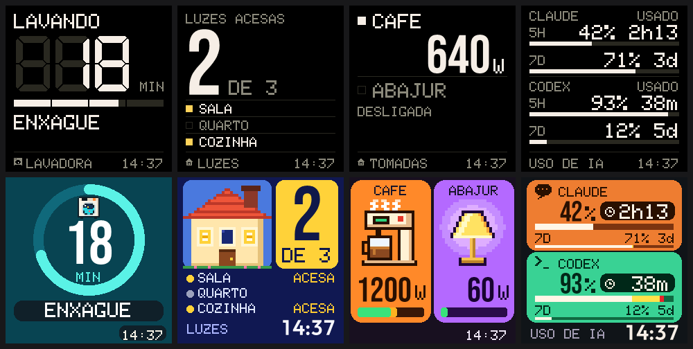
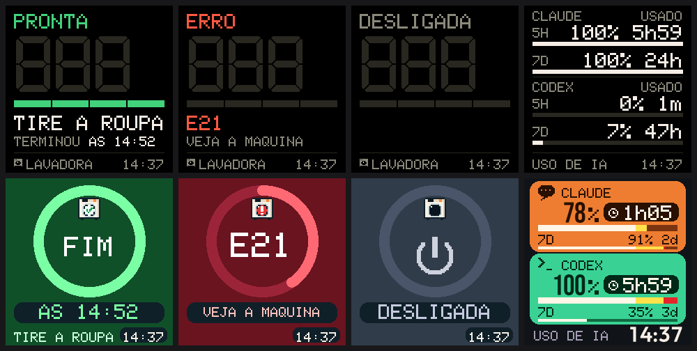
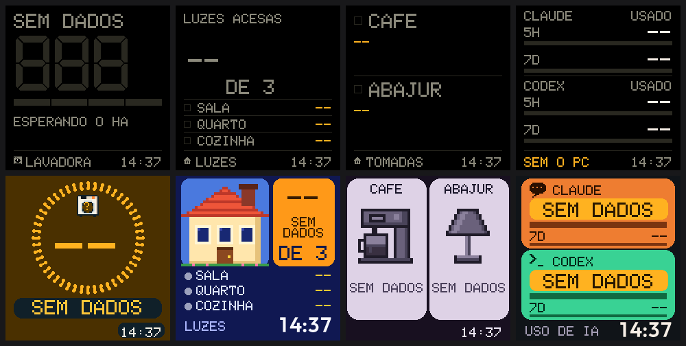
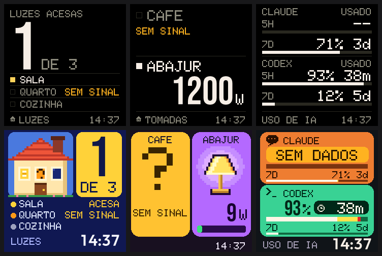
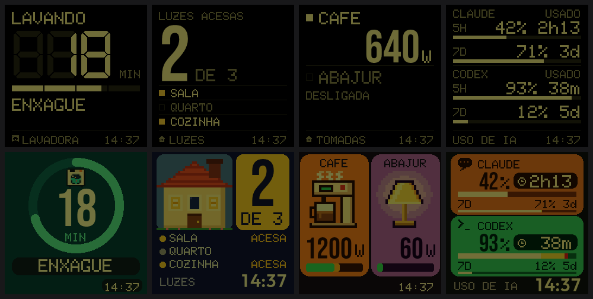

# Design dos miniapps

Diretriz para a tela de um miniapp: um pacote do [formato 2](PACOTES.md#formato-2-firmware-1260) que mostra dados que chegam de fora
(`{x.campo}`, `when` e `value`). Vale junto com as [diretrizes de mostrador](PACOTES.md#diretrizes-de-design) (área segura, escuro à noite,
tingimento âmbar). Aqui entra o que é só de miniapp: o dado vem de fora, pode faltar, pode estar parado e a tela precisa **mudar de forma clara**
com ele. Os números de limite (camadas, referências, bytes) ficam só em [Limites](PACOTES.md#limites).

Em uma frase: **cor viva em blocos grandes, um ponto focal que se lê em 1 segundo a 1 metro, ícone em vez de cena cheia, cor que diz o estado e a hora
sempre no mesmo canto.**

Nas imagens abaixo, em cima está o miniapp antes e embaixo o depois (simulador, 240 × 240).

## De onde vem

- **Os mostradores do próprio relógio** (bento, pilula, duo, quartinho, jardim…): fundo colorido, blocos cheios de cor com cantos arredondados,
  pixel art com uma coisa só desenhada com carinho, tipografia grande. O miniapp tem de parecer da mesma família, não um painel preto com linha fina.
- **TokenTV** ([click6067-ship-it/token-tv](https://github.com/click6067-ship-it/token-tv), código sob licença MIT, © 2026 click6067-ship-it), que mostra os
  limites de uso de assistentes de IA num SmallTV de fábrica. Seguimos a linguagem visual; não copiamos código, fonte, imagem, ícone, personagem nem marca.
  O que as faces dele ensinam (as oito: Digital, Neon, Pixel Retro, HUD, Pixel, Space, Game Boy e Arcade):

| Lição | Como aparece no TokenTV | Como usamos |
|---|---|---|
| Um número domina | o percentual usado em fonte de peso; o resto é menor | o ponto focal de cada tela (minutos, contagem, watts, percentual) |
| Poucos elementos | 5 a 7 por item; as faces mais legíveis a 1 m (Pixel, Space) têm 3 a 5 | no máximo um ponto focal e 3 ou 4 apoios por tela |
| A barra diz "perto do limite" | a barra muda de cor por faixa (verde, lima, laranja, vermelho); não há texto de alerta | barra "zonada" (regra 3) |
| Identidade por cor | cada provedor tem sua cor e seu ícone | um bloco de cor por assunto (laranja e verde no Uso de IA, laranja e violeta nas tomadas) |
| Sem dado não é zero | `--` e barra oca | regra 4 |
| Velho tem de parecer velho | rótulo `OLD`, barra hachurada | regra 5 |
| Enfeite demais cansa | a face Pixel Retro, a mais enfeitada, é a menos legível | ícone pequeno em vez de cena cheia |

## As regras

### 1. Um ponto focal; o resto apoia

Dê o maior tamanho a **uma** coisa (os minutos que faltam, quantas luzes estão acesas, os watts, o percentual de uso) e deixe o resto em rótulo.
Se o olho precisa de mais de um segundo para saber o que a tela diz, tire elementos. Nada encosta em nada: deixe pelo menos 4 px entre elementos.

| Papel | Fonte e tamanho |
|---|---|
| Ponto focal | `bebas` (ou `outfit`, `dseg`) de 36 a 100 px: só desenham dígitos |
| Unidade, rótulo curto, estado | `pixel` 2 a 4 (`pixel` 2 só para rótulo; nada menor) |
| Nome do item | `pixel` 2 ou 3 |
| Hora | `pixel` 2 ou `outfit` ~22, sempre no mesmo lugar (regra 6) |

Cada campo é um texto de um tamanho só: `42% 2h13` num campo sai tudo do mesmo tamanho. Para o percentual ser maior que o tempo, o remetente manda dois
campos. Planeje isso antes de desenhar (o armazém do relógio é pequeno e dividido entre todos os remetentes; veja [HOME-ASSISTANT.md](HOME-ASSISTANT.md)).

### 2. Cor em bloco e cor que diz o estado

A tela é um bloco de cor (ou alguns). A cor não é gosto: é estado, e é a mesma em todo miniapp.

| Estado | Cor (exemplos dos pacotes) |
|---|---|
| em andamento, normal | turquesa `#5ff0e0` sobre azul-petróleo `#0b4654` |
| pronta, ligada, dentro do limite | verde `#3be07f` / `#7dffa6` |
| sem sinal, sem dados, atenção | âmbar `#ffb020` / `#ffc233` |
| erro, perto do limite | vermelho `#ff6a70` sobre vinho `#6a1424` |
| desligada, apagada | grafite `#363d4e` / `#948ba3` |
| lâmpada acesa | amarelo `#ffd23f` |
| texto | claro `#f4f6ff` sobre escuro, escuro `#14202e` sobre bloco claro |

Cada assunto pode ter o seu bloco de cor de identidade (laranja, violeta, turquesa), mas o que muda **com o dado** é só a cor do estado: verde, âmbar,
vermelho, grafite. Sem azul puro em texto (à noite o azul perde até 45 %). Cores vizinhas com pelo menos um degrau claro (o RGB565 funde quase-iguais).

**Barra por faixa sem campo novo.** O motor não compara números, então a barra de uso é "zonada": três `bar` sobrepostas com o mesmo `value` e larguras e `max`
diferentes (vermelha de 0 a 100 % por baixo, amarela de 0 a 90 %, clara de 0 a 70 %), como um tacômetro com faixa vermelha. Para um valor que pode ser muito
pequeno (watts), acrescente uma barrinha de 8 a 10 px com `max` 1: qualquer valor a partir de 1 a enche e o "tem consumo" aparece. Para progresso de ciclo,
o `arc` (anel) com o valor no centro.

### 3. Ícone pequeno, não cena cheia

Um ícone de pixel art de 16 a 32 px em `size` 2 a 4, bem desenhado, diz o assunto (máquina de lavar, casinha, cafeteira, lâmpada) e custa poucas centenas de
bytes. Mude o ícone com o estado (tambor girando, janela acesa, vapor, halo). Uma cena inteira de tiles cheia de móveis ocupa o orçamento todo, perde o ponto
focal e anima demais. Animação só pequena, 2 a 4 quadros, 2 a 3 fps, e nunca cobrindo a hora.

### 4. Sem dados: o mesmo jeito sempre

"Sem dados" é o dado que nunca chegou ou venceu (`ttl`). Mostre sempre: bloco pálido ou âmbar, `--` onde ficaria o ponto focal, ícone apagado ou com `?`, o
texto SEM DADOS (nos três idiomas) e nada de zero falso. Não pode se confundir com "desligada" (grafite, ícone de liga/desliga, a palavra DESLIGADA).

### 5. Velho e falha: o último valor continua à vista, marcado

O motor não guarda a idade de um campo: quando o `ttl` vence, o dado volta a "sem dados". Dado velho ou falha com o valor à vista só existe quando **quem envia**
avisa (o Home Assistant manda `SEM SINAL` no campo de estado de uma luz ou tomada): a tela fica âmbar, com um `?` grande e o texto. No Uso de IA, a janela sem
leitura mostra SEM DADOS na linha, com a barra vazia.

### 6. A hora fica sempre visível, no mesmo canto

Quando o miniapp entra no rodízio dos mostradores, a hora não pode sumir. Todo miniapp mostra `{HH}:{MM}` (`pixel` 2 ou `outfit` ~22) no mesmo canto
(embaixo, à direita, x = 228), sobre um fundo de contraste (bloco escuro se a ilustração for clara). Nenhum estado esconde a hora.

### 7. Legível em 1 segundo a 1 metro, e à noite

- Texto de leitura a 4,5:1 ou mais sobre o fundo; texto a 12 px ou mais das bordas (os blocos de cor podem ir até a borda).
- À noite o relógio tinge a tela (azul −45 %) e baixa a luz. Confira o caso noturno: lâmpada acesa continua mais clara que a apagada, âmbar continua âmbar,
  ligada continua bem diferente de desligada só pela cor, pelo ícone e pelo número.
- Cinza escuro some com brilho baixo: use grafite claro (`#948ba3`) em vez de cinza-escuro para o que precisa aparecer.

### 8. O desenho cabe no contrato

Redesenhar a tela **não muda os nomes nem o formato dos campos**: as receitas do Home Assistant e o companheiro do PC continuam valendo (o `appdata_test` confere a
lista de campos de cada exemplo). Dentro do contrato, o orçamento aperta: cada camada, cada `x.campo` e cada `x.campo=VALOR` que o pacote lê conta. Os exemplos
usam 29 a 38 camadas, 6 a 8 referências e até 1,5 KB de sprites: **conte antes de desenhar**. `x.campo` é falso para `""` e para `"0"`: use `x.campo=0`
quando o zero for um valor legítimo.

## O que evitar

| Sinal | Em vez disso |
|---|---|
| Painel preto com contorno fino e tudo do mesmo tamanho | blocos de cor e um ponto focal |
| Cena cheia (móveis, cesta, planta, prateleira) | um ícone bem desenhado |
| Texto apertado: nome e estado se tocando | conte as larguras (`pixel` 2 = 12 px por letra, `pixel` 3 = 18) e deixe 4 px de folga |
| Cor por gosto, azul puro em texto | cor só para estado; azul só em bloco claro |
| Zero no lugar de "não sei" | `--` e barra vazia |
| "Desligada" parecida com "sem dados" | grafite com ícone de liga/desliga x âmbar com `?` |
| Animação grande, rápida, piscando | 2 a 4 quadros, 2 a 3 fps, só quando o estado pede |
| Marca, logo, mascote de terceiros | ícone genérico desenhado do zero (balão de fala, `>_`) |

## Checklist para quem faz miniapp

1. Um ponto focal; o resto em `pixel` 2 ou 3, nada menor; 4 px de folga entre elementos.
2. Bloco de cor de identidade; cor de estado igual à tabela (verde, âmbar, vermelho, grafite); sem azul puro em texto.
3. Ícone pequeno em vez de cena; animação pequena e calma.
4. Sem dados, desligada e falha são inconfundíveis de relance; nenhum zero falso.
5. Hora no mesmo canto em todos os estados, sobre um fundo de contraste.
6. Campos congelados: nenhum nome ou formato mudou em relação à receita publicada.
7. Camadas, referências e sprites contados (a conta vai na descrição do PR); textos de pior caso (`SEM SINAL`, `1200` W, `100% 5h59`) conferidos nos três idiomas.
8. Prévia do simulador com todos os estados (sem dados, normal, alerta, falha, pior caso) e a prévia noturna.
9. Foto no relógio, na prévia de 15 s do painel, de cada estado antes de publicar: o simulador não mostra o gama do IPS nem a moldura.
10. Crédito: se é remix ou inspiração, diga a origem (aqui: TokenTV, MIT) em `desc`/README, sem copiar arte nem marca.
