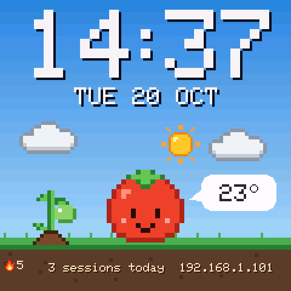

  

<h1 align="center">SmallTV Pomodoro</h1>

  
  
  
  

  
  

**Um timer de foco na mesa que não é o celular.** Firmware de código aberto para o GeekMagic SmallTV Ultra (ESP8266): Pomodoro com um tomate em pixel art, mostradores, clima e um painel web. Sem conta, sem nuvem e sem cabo para instalar.

<!-- GIF aqui: o mesmo docs/hero.gif do README em inglês (troque pelo GIF do relógio real com o mesmo nome). -->

Feito com o simulador do projeto, que compila o mesmo código de desenho do firmware. Uma gravação do relógio de verdade vem em breve.

  

  <a href="https://davicorrea0.github.io/smalltv-pomodoro/docs.html#primeiros-passos">Guia de instalação</a> ·
  <a href="https://davicorrea0.github.io/smalltv-pomodoro/versoes.html">Versões</a> ·
  <a href="../README.md">In English</a>

## Por quê

- **O timer é o centro.** Um anel de progresso, o horário de término e um tomate que reage: focado no trabalho, com um café na pausa, dormindo quando pausado e pulando quando a fase acaba. O relógio guarda um ano de focos por dia, e uma planta cresce com a sua sequência até o tomate dourado.
- **Instala sem cabo.** Você envia o arquivo pela própria página de fábrica do relógio, como uma atualização comum. Algumas unidades precisam antes de um carregador pequeno ([detalhes](#instalar)).
- **Atualizações confiáveis.** As atualizações pela rede são assinadas (RSA-2048) e o relógio confere o arquivo inteiro antes de trocar. Se algo ainda der errado, o **modo de recuperação sem botão** (ligar e desligar 3 vezes) deixa regravar ou voltar ao firmware original.
- **Muitos mostradores, cada um num arquivo pequeno.** Uma dúzia embutidos e mais de 40 na [galeria](https://davicorrea0.github.io/smalltv-pomodoro/galeria.html), que se instalam pelo painel sem atualizar o firmware.
- **Feito para quem usa, não só para quem mexe.** Painel e tela em português, inglês e espanhol, com telas próprias para celular e computador. Um pequeno [jogo do foco](https://davicorrea0.github.io/smalltv-pomodoro/jogo.html) (sequência, horta, conquistas, cartão do dia) e um álbum de fotos e GIFs.

## É o meu aparelho?

| Aparelho | Chip | Funciona? |
|---|---|---|
| **GeekMagic SmallTV Ultra** | ESP8266 | ✅ Sim. É o aparelho para o qual o firmware é feito e testado. |
| GeekMagic SmallTV (o original, não Ultra) | ESP8266 | ❔ Não testado. Não grave se você não souber regravar pela serial. |
| GeekMagic SmallTV Pro e outros relógios ESP32 / ESP32-C2 | ESP32 | ❌ Não. Outro chip; não grave. |

Na dúvida: no Ultra o firmware de fábrica tem a marca *Ultra* (a página dele mostra uma versão como `Ultra-V9.0.x`), e enviar um firmware grande ali dá `Not Enough Space` (o carregador do passo 2 resolve). A [tabela do smalltv-mod](https://github.com/giovi321/smalltv-mod#which-one-do-i-have) tem fotos de cada modelo.

## Instalar

Você precisa do relógio, de um celular ou computador no mesmo Wi-Fi e de uma rede de **2,4 GHz** (o ESP8266 não tem 5 GHz).

1. **Baixe** o `.bin` mais recente em [Releases](https://github.com/davicorrea0/smalltv-pomodoro/releases/latest).
2. **Envie** pela página de fábrica do relógio (abra o IP que aparece na tela), em **Firmware Upgrade**. O relógio reinicia sozinho.
   - Apareceu `ERROR[4]: Not Enough Space`? O espaço de atualização de fábrica varia entre unidades. Envie antes o carregador [`smalltv-mod-loader.bin`](https://github.com/giovi321/smalltv-mod/releases/tag/v2.8.2) (do giovi321/smalltv-mod v2.8.2), conecte-se à rede aberta `SmallTV-Loader` e envie este firmware em `http://192.168.4.1/update`.
     - **A tela fica preta com o carregador, e isso é normal.** O relógio está ligado, esperando o próximo passo.
     - **Não desligue o relógio até aparecer a tela do Pomodoro (o QR do Wi-Fi).** Ele reinicia sozinho depois do envio.
3. **Conecte ao Wi-Fi.** Se ele não entrar sozinho na sua rede, leia o QR da tela com o celular e escolha a rede. Se não conectar, não tire da tomada para tentar de novo: 3 reinícios seguidos, com menos de 30 s ligado em cada um, abrem o modo de recuperação (seguro, mas confunde).
4. **Abra o painel** no IP que aparece na tela (ou em `http://smalltv.local/`). As próximas atualizações são um toque no painel.

> Instalar formata a memória de arquivos do relógio: as fotos do firmware de fábrica não ficam. O Wi-Fi salvo continua; os ajustes começam do zero.

O [guia passo a passo](https://davicorrea0.github.io/smalltv-pomodoro/docs.html#primeiros-passos) tem imagens, como achar o painel e o que fazer se algo falhar.

### Se algo der errado

Se o relógio travar ou ficar reiniciando, **tire da tomada e ligue de novo 3 vezes seguidas, deixando ligado menos de 30 segundos em cada vez**. Ele abre o **modo de recuperação**: conecte-se à rede `SmallTV-Recuperacao` (a senha aparece na tela) e abra `http://192.168.4.1` para enviar um firmware, voltar aos ajustes de fábrica ou baixar o histórico de focos. Dali também dá para voltar ao [firmware original da GeekMagic](https://github.com/GeekMagicClock/smalltv-ultra) (faça um backup no painel antes). Se nem o modo de recuperação abrir, veja [RECUPERACAO.md](RECUPERACAO.md) para regravar pela serial.

## Recursos

- **Pomodoro** com foco, pausa curta e longa, meta do dia, a atividade que você está fazendo (ler, estudar, programar, tarefas, desenhar) e o horário de término na tela.
- **Histórico de focos:** um ano de focos por dia, sequência, horta do ano, 10 conquistas e um cartão do dia em pixel art para compartilhar.
- **13 mostradores embutidos** (Tomate, Flip, Neon, LCD retrô, Palavras, Previsão, Mundo e outros) e **41 para instalar**. Escolha os favoritos e o relógio alterna entre eles.
- **Clima** pelo [Open-Meteo](https://open-meteo.com/), sem chave de API: previsão de 5 dias, °C ou °F e aviso quando a chuva começa na próxima hora (o tomate abre o guarda-chuva).
- **Fotos e GIFs**, recortados para 240×240 no navegador.
- **Brilho noturno** que segue o pôr e o nascer do sol, ou um horário fixo.
- **Alexa**, sem conta nem skill: começa, pausa e encerra o timer pela voz, na rede local.
- **Painel** com senha opcional, backup e restauração, diagnóstico e versões de teste para quem quiser antes.

Veja todos os mostradores na [galeria](https://davicorrea0.github.io/smalltv-pomodoro/galeria.html), o que mudou em cada [versão](https://davicorrea0.github.io/smalltv-pomodoro/versoes.html) e como usar tudo na [documentação](https://davicorrea0.github.io/smalltv-pomodoro/docs.html). A lista completa e os detalhes técnicos estão em [TECHNICAL.md](TECHNICAL.md) (em inglês).

## Projetos relacionados

- **[smalltv-mod](https://github.com/giovi321/smalltv-mod)**, do giovi321, é um projeto parceiro para a mesma família de relógios: cotações de ações e cripto, telas do Home Assistant, temas com editor visual e suporte a cinco modelos. O carregador dele é o que faz a nossa instalação funcionar em algumas unidades, e os dois projetos estão trabalhando num [formato de mostrador em comum](https://github.com/giovi321/smalltv-mod/issues/31).

## Perguntas frequentes

**Dá para voltar ao firmware original?** O modo de recuperação aceita qualquer firmware, inclusive o `.bin` da GeekMagic. As fotos e o histórico de focos ficam para trás, então faça um backup no painel antes. Desde o layout de memória da 1.24, essa volta ainda não foi testada num relógio de verdade.

**Precisa de internet ou de conta?** De conta, não. Com internet ele pega a hora, o clima (Open-Meteo) e as atualizações do site do projeto. O timer e os mostradores funcionam sem internet depois que a hora está certa, desde que o relógio continue na tomada.

**As fotos do relógio continuam depois da instalação?** Não: instalar formata a memória de arquivos. O Wi-Fi salvo continua; os ajustes começam do zero. Envie as fotos de novo pelo painel.

**É seguro?** O relógio confere cada atualização (tamanho, CRC, descompressão completa e a assinatura do projeto) antes de trocar, e o firmware atual continua se algo falhar. Gravar qualquer firmware de terceiros continua sendo por sua conta e risco.

**Onde aviso de um problema?** Em [Issues](https://github.com/davicorrea0/smalltv-pomodoro/issues), em português ou inglês. O cartão *Diagnóstico* do painel (por que reiniciou, memória, sinal do Wi-Fi) ajuda muito.

## Como contribuir

Relatos de problemas, ideias e "funcionou na minha unidade" são bem-vindos em [Issues](https://github.com/davicorrea0/smalltv-pomodoro/issues).

- **Mostrador novo sem compilar:** um pacote `.json` pequeno; veja [PACOTES.md](PACOTES.md) e a pasta [`faces/`](../faces).
- **Mostrador embutido ou código:** o [simulador](TECHNICAL.md#screen-simulator) desenha todas as telas no PC, sem gravar o relógio; como compilar e testar está em [TECHNICAL.md](TECHNICAL.md#building). Guia de mostrador embutido: [CRIAR_MOSTRADOR.md](CRIAR_MOSTRADOR.md).
- **Pixel art:** cada sprite é um arquivo de texto em [`assets/`](../assets) ([como](TECHNICAL.md#asset-library)).

PRs pequenos, um assunto cada, são os mais fáceis de revisar. Toda mudança no firmware passa pelo simulador e pela compilação no GitHub Actions.

⭐ Se você gostou, uma estrela ajuda outros donos deste relógio a achar o projeto.

## Créditos e licença

Créditos completos no [README em inglês](../README.md#credits). Código, pixel art e mostradores sob a [GNU GPL v3](../LICENSE) (GPL-3.0-or-later): pode usar, estudar, mudar e compartilhar; versões modificadas que você distribuir também precisam ser GPL, com o código aberto. As partes de terceiros mantêm as licenças delas (cópias em [`licenses/`](../licenses)).

GeekMagic e SmallTV são marcas dos seus donos. Este é um projeto independente, sem ligação com a GeekMagic.
