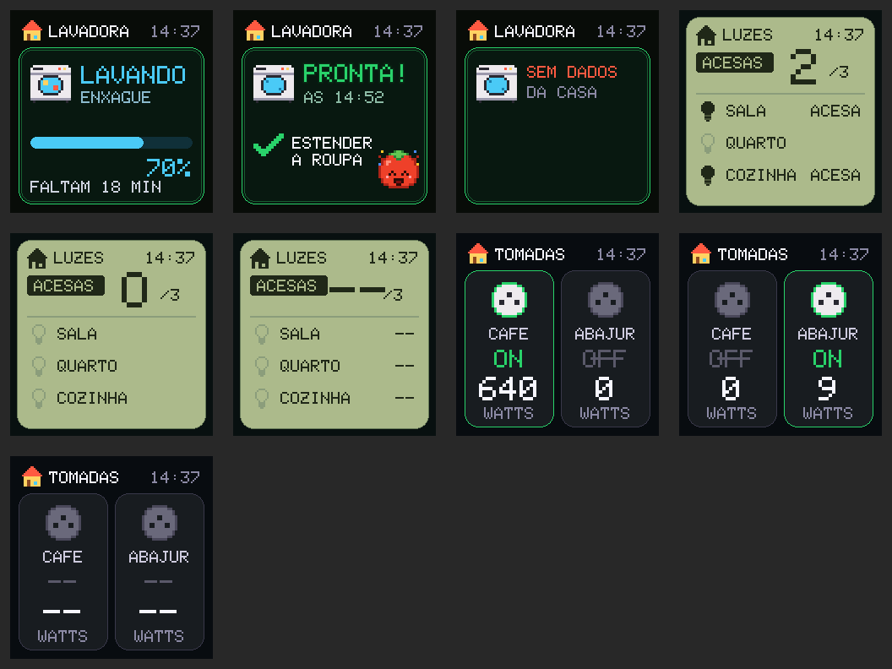

# Exemplos: miniapps da casa com o Home Assistant

Três mostradores que desenham o que o Home Assistant manda ao relógio: a **lavadora**, as **luzes** e duas
**tomadas**. Eles ficam fora da galeria de propósito: sem o Home Assistant configurado, a tela fica em `--`, e os
nomes dos cômodos e das tomadas estão escritos no próprio arquivo.



Antes, siga a [receita do Home Assistant](../HOME-ASSISTANT.md): crie a chave no painel e o `rest_command`
`smalltv_dados`. Depois, para cada mostrador que quiser:

1. Baixe o `.json` (abra o arquivo aqui no GitHub e use "Download raw file").
2. Se quiser, troque os nomes (`"SALA"`, `"CAFE"`...) no arquivo. Use até 7 letras, sem acento.
3. No painel do relógio, vá em Relógio → Mais mostradores → **Instalar de um arquivo**.
4. Cole a automação correspondente abaixo no Home Assistant, trocando os nomes das entidades.

Os três juntos usam 12 dos 16 campos do relógio. Cada um usa um prefixo próprio (`lv_`, `lz_`, `tm_`) para não pisar
no outro.

## Luzes (`casa-luzes.json`)

`lz_n` é quantas estão acesas. `lz_1` a `lz_3` valem `ACESA`, ou vazio quando a luz está apagada.

```yaml
automation:
  - alias: "SmallTV: luzes"
    mode: queued
    max: 2
    trigger:
      - platform: state
        entity_id: [light.sala, light.quarto, light.cozinha]
      - platform: time_pattern
        minutes: "/5"
        seconds: "20"
    action:
      - service: rest_command.smalltv_dados
        data:
          payload: >-
            {"ttl": 900, "values": {
              "lz_n": {{ ['light.sala', 'light.quarto', 'light.cozinha'] | select('is_state', 'on') | list | count }},
              "lz_1": "{{ 'ACESA' if is_state('light.sala', 'on') else '' }}",
              "lz_2": "{{ 'ACESA' if is_state('light.quarto', 'on') else '' }}",
              "lz_3": "{{ 'ACESA' if is_state('light.cozinha', 'on') else '' }}"}}
```

## Tomadas (`casa-tomadas.json`)

`tm_1` e `tm_2` valem `1` (ligada) ou `0`. `tm_w1` e `tm_w2` são os watts. Se a tomada não mede consumo, tire os
`tm_w`: o cartão mostra `--`.

```yaml
automation:
  - alias: "SmallTV: tomadas"
    mode: queued
    max: 2
    trigger:
      - platform: state
        entity_id: [switch.cafe, switch.abajur, sensor.cafe_potencia, sensor.abajur_potencia]
      - platform: time_pattern
        minutes: "/5"
        seconds: "40"
    action:
      - service: rest_command.smalltv_dados
        data:
          payload: >-
            {"ttl": 900, "values": {
              "tm_1": {{ 1 if is_state('switch.cafe', 'on') else 0 }},
              "tm_w1": {{ states('sensor.cafe_potencia') | float(0) | round(0) | int }},
              "tm_2": {{ 1 if is_state('switch.abajur', 'on') else 0 }},
              "tm_w2": {{ states('sensor.abajur_potencia') | float(0) | round(0) | int }}}}
```

Um sensor de potência que muda a cada segundo dispara a automação a cada segundo. Nesse caso, tire o sensor do
`trigger` e deixe só o `switch` e o envio a cada 5 minutos.

## Lavadora (`casa-lavadora.json`)

Os campos e o que a tela mostra em cada estado:

| Campo | LAVANDO | PRONTA | DESLIGADA |
|---|---|---|---|
| `lv_est` | `LAVANDO`: tambor girando | `PRONTA`: "PRONTA!" e o tomate comemorando | `DESLIGADA` |
| `lv_txt` | a etapa (`ENXAGUE`) | a hora do fim (`AS 14:52`) | vazio |
| `lv_pct` | quanto do ciclo já foi (barra) | 100 | 0 |
| `lv_min` | minutos que faltam | 0 | 0 |

A receita manda só enquanto a máquina lava ou está pronta. Parada, ela não manda nada, e o dado vence em 15 minutos:
a tela mostra "SEM DADOS DA CASA". `DESLIGADA` continua no desenho para quem quiser mandar esse estado de outro jeito.

**Lavadora Midea** (conferido em 16/11/2026):

- O Home Assistant tem uma integração oficial da Midea desde a versão **2026.8**
  ([home-assistant.io/integrations/midea](https://www.home-assistant.io/integrations/midea)), com lavadoras de abertura
  frontal e superior. Depois de configurada, ela fala com a máquina só pela rede local.
- A página não lista os nomes dos sensores da lavadora. A integração da comunidade `midea_ac_lan`
  ([doc da lavadora](https://github.com/wuwentao/midea_ac_lan/blob/master/doc/DB.md)) mostra status, etapa (progress),
  programa e tempo restante.
- Confira em Configurações → Dispositivos quais sensores a sua mostra e troque os nomes abaixo.

O `lv_pct` sai do tempo restante: no começo do ciclo, o Home Assistant guarda o total e calcula quanto já passou.

```yaml
input_number:
  lavadora_total: { min: 0, max: 600, step: 1 }
input_text:
  lavadora_fim: { max: 5 }
input_boolean:
  lavadora_pronta:

automation:
  - alias: "Lavadora: começou"
    trigger:
      - platform: numeric_state
        entity_id: sensor.lavadora_time_remaining
        above: 0
    condition: "{{ states('input_number.lavadora_total') | float(0) == 0 }}"
    action:
      - service: input_number.set_value
        target: { entity_id: input_number.lavadora_total }
        data: { value: "{{ states('sensor.lavadora_time_remaining') | float(0) }}" }
      - service: input_boolean.turn_off
        target: { entity_id: input_boolean.lavadora_pronta }
  - alias: "Lavadora: terminou"
    trigger:  # com a máquina desligada o sensor pode ficar "unavailable": o int(0) conta isso como 0
      - platform: template
        value_template: "{{ states('sensor.lavadora_time_remaining') | int(0) < 1 }}"
        for: "00:01:00"
    condition: "{{ states('input_number.lavadora_total') | float(0) > 0 }}"
    action:
      - service: input_text.set_value
        target: { entity_id: input_text.lavadora_fim }
        data: { value: "{{ now().strftime('%H:%M') }}" }
      - service: input_boolean.turn_on
        target: { entity_id: input_boolean.lavadora_pronta }
      - service: input_number.set_value
        target: { entity_id: input_number.lavadora_total }
        data: { value: 0 }
  - alias: "Lavadora: esquece o pronta"
    trigger:
      - platform: state
        entity_id: input_boolean.lavadora_pronta
        to: "on"
        for: "02:00:00"
      - platform: state
        entity_id: switch.lavadora_power
        to: "off"
    action:
      - service: input_boolean.turn_off
        target: { entity_id: input_boolean.lavadora_pronta }
  - alias: "SmallTV: lavadora"
    mode: queued
    max: 2
    trigger:
      - platform: state
        entity_id: [sensor.lavadora_time_remaining, sensor.lavadora_progress, input_boolean.lavadora_pronta]
      - platform: time_pattern
        minutes: "/5"
        seconds: "0"
    condition:  # só lavando ou pronta: parada, o dado vence sozinho e a lavadora sai de cena
      - "{{ states('sensor.lavadora_time_remaining') | int(0) > 0 or is_state('input_boolean.lavadora_pronta', 'on') }}"
    action:
      - service: rest_command.smalltv_dados
        data:
          payload: >-
            
            
            
            
            {"ttl": 900, "values": {
              "lv_est": "{{ 'LAVANDO' if lavando else 'PRONTA' }}",
              "lv_txt": "{{ (states('sensor.lavadora_progress') | upper | regex_replace('[ÁÀÂÃ]', 'A') | regex_replace('[ÉÊ]', 'E')
                          | regex_replace('Í', 'I') | regex_replace('[ÓÔÕ]', 'O') | regex_replace('Ú', 'U') | regex_replace('Ç', 'C')
                          | regex_replace('[^A-Z0-9 :%-]', ''))[:11] if lavando
                          else 'AS ' ~ states('input_text.lavadora_fim') }}",
              "lv_pct": {{ ((tot - rem) * 100 / tot) | round(0) | int if lavando and tot > 0 else 100 if pronta else 0 }},
              "lv_min": {{ rem }}}}
```

- **Etapa em inglês ou em código** ("rinse", "3"): troque o `states(...)` por um mapa, como
  `{'wash': 'LAVAGEM', 'rinse': 'ENXAGUE', 'spin': 'CENTRIFUGA'}`. Se não houver sensor de etapa, use o programa.
- **Lavadora sem integração**, numa tomada que mede consumo: o Home Assistant deduz o estado pelo consumo. Acima de
  ~10 W por 1 min, está `LAVANDO`; abaixo de ~3 W por 5 min, depois de lavar, está `PRONTA`. O tempo restante vira
  estimativa pela duração típica do seu ciclo.
- Cada valor tem até 15 bytes, e na linha da etapa cabem 11 letras. A receita tira os acentos (o relógio não os desenha
  e cada letra acentuada ocupa 2 bytes) e corta em 11 com `[:11]`. Não use `truncate(11)`: o Home Assistant deixa
  passar até 5 letras a mais, e um valor acima de 15 bytes faz o relógio recusar o envio inteiro.
- As três automações mandam a cada 5 minutos. Use segundos diferentes em cada `time_pattern` (`seconds: 0`, `20`,
  `40`) para não chegarem as três no mesmo instante.
