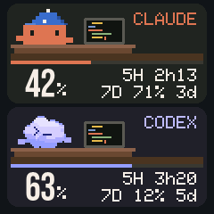

# tokensmall: uso de IA no relógio

O SmallTV Pomodoro mostrando os limites de **5 horas e de 7 dias** do Claude e do Codex, no firmware próprio (sem
subir imagem, sem escrever na flash). Um programa pequeno no PC lê os números e empurra para o relógio; o relógio só
recebe percentuais e tempo até reiniciar.

> **Rascunho.** Depende da rota de dados de fora (`POST /api/apps/data`, PRs #110 e #111), que ainda não está numa
> versão publicada. Por isso o pacote fica em [`sim/apps-seeds/tokensmall.json`](../../sim/apps-seeds/tokensmall.json),
> fora de `faces/` e do catálogo da galeria, e só sobe para lá quando a rota estiver numa versão.

## Como funciona

```
 Claude Code ── statusLine ──► tokensmall.py statusline ──► limites do Claude (arquivo local, só números)
 Codex ── arquivos de sessão ─► lidos só pelo tokensmall.py (últimas linhas "rate_limits")
                                         │
                tokensmall.py enviar ────┘   POST /api/apps/data   {"ttl":900,"values":{"tk_c5":"42","tk_c5r":"2h13",...}}
                                         ▼
                      relógio: a tela lê {x.tk_c5}, {x.tk_c5r}, {x.tk_c7}, {x.tk_x5}, {x.tk_x5r}, {x.tk_x7}
```

| Campo | O que é | Exemplo |
|---|---|---|
| `tk_c5` | Claude, 5 h: só o percentual usado (inteiro de 0 a 100, até 3 caracteres) | `42` |
| `tk_c5r` | Claude, 5 h: tempo até reiniciar (até 5 caracteres) | `2h13`, `38m` |
| `tk_c7` | Claude, 7 dias: percentual e tempo até reiniciar | `71% 3d` |
| `tk_x5`, `tk_x5r` | Codex, 5 h: percentual e tempo até reiniciar | `93`, `38m` |
| `tk_x7` | Codex, 7 dias: percentual e tempo até reiniciar | `71% 3d` |

O percentual da janela de 5 h vai **separado** do tempo porque a fonte grande da tela só desenha dígitos. A janela de
7 dias continua num texto só (`71% 3d`, até 9 caracteres). Cada valor tem no máximo 15 bytes e o envio leva até 8 campos;
6 cabem. Sem leitura de uma janela (sem dado, velha demais ou reinício que já passou), nunca vai `0`: a de **5 h** vai
como texto vazio (`""`) nos dois campos, `tk_?5` e `tk_?5r`, e a tela mostra "SEM DADOS" nessa linha; a de **7 dias**
vai como `--`. O companheiro manda sempre os 6 campos: o relógio guarda cada campo com a validade do envio que o trouxe,
então um campo que simplesmente deixasse de ser enviado continuaria na tela até vencer. Sem leitura em nenhuma janela,
nada é enviado. Se o PC parar de enviar por 15 minutos (`ttl`), a tela esvazia.

## Regra da K13: credencial não sai da máquina

| O programa faz | O programa NÃO faz |
|---|---|
| Lê o JSON que o Claude Code entrega ao `statusLine` e guarda só `rate_limits` (percentual e horário) | Abrir `auth.json`, `.credentials.json`, Keychain ou cookies |
| Lê só as linhas `rate_limits` das sessões recentes do Codex em `~/.codex/sessions` | Chamar API de assinatura (nem `api.anthropic.com`, nem `chatgpt.com`) |
| Envia 6 textos curtos a um IP da rede local | Guardar ou enviar token de login, caminho de projeto, nome de cliente ou texto de conversa |
| Usa a **chave de escrita do relógio** (32 hex, criada por você no painel) da variável `SMALLTV_CHAVE`, em `Authorization: Bearer`, só para o IP local | Gravar ou imprimir essa chave; usar a senha do painel; mandar a chave a algo que não seja o relógio |

A chave de escrita só deixa gravar dados nos campos: não abre o painel nem a atualização do firmware. Ela vive em dois
lugares, no `/apps.key` do relógio e na variável de ambiente do seu PC, e é você quem a coloca lá. Texto que não tem o
formato de uma chave (por exemplo a senha do painel) é recusado antes de abrir a conexão.

Os testes (`test_tokensmall.py`) vigiam isso: um `auth.json` falso ao lado das sessões nunca é aberto, nenhum texto
da conversa ou do `statusLine` chega ao disco ou ao relógio, e o código não contém referência a login ou API de
assinatura. O destino precisa ser IP privado ou nome `.local`, o envio **não usa proxy** (nem o do ambiente nem o do
Windows) e **não segue redirecionamento**: assim a chave só chega ao relógio, e há teste com um proxy e um
redirecionamento de mentira que não podem receber nada.

## Instalar

Precisa de um firmware com `POST /api/apps/data` e da chave de escrita criada.

1. **Chave:** no painel do relógio, *Ajustes → Home Assistant*, crie a chave de escrita. No terminal onde vai rodar o
   companheiro, defina `SMALLTV_CHAVE` com ela (não ponha em arquivo, commit nem script compartilhado).
2. **Pacote:** no painel, *Relógio → Mais mostradores → Instalar de um arquivo*, escolha
   [`sim/apps-seeds/tokensmall.json`](../../sim/apps-seeds/tokensmall.json).
3. **Claude Code:** peça os limites no `statusLine`. Em `~/.claude/settings.json` (você mesmo edita):
   ```json
   { "statusLine": { "type": "command", "command": "python \"C:/caminho/miniapps/tokensmall/tokensmall.py\" statusline" } }
   ```
   O comando imprime `5h 42% · 7d 71%` na barra do Claude Code. Se você já tem um `statusLine`, chame o tokensmall no
   seu script com o mesmo JSON de entrada e sem imprimir: `echo "$entrada" | python tokensmall.py statusline --silencioso`.
   O Claude Code só informa os limites a assinantes Pro/Max e só depois da primeira resposta de cada sessão.
4. **Enviar:** com o IP do relógio (o que aparece na tela dele):
   ```bash
   python miniapps/tokensmall/tokensmall.py ver                      # mostra o que seria enviado, sem rede
   python miniapps/tokensmall/tokensmall.py enviar --relogio 192.168.1.50
   ```
   `--uma-vez` envia uma vez e sai; sem ele o programa fica rodando (lê a cada 60 s e reenvia quando algo muda, em geral a cada minuto, porque o tempo até reiniciar anda).

## O que a tela mostra

Um cartão por assistente com duas linhas (5 horas e 7 dias). A linha de 5 horas destaca o percentual **usado** em número grande (`42`, de `tk_?5`) e, ao lado, o tempo até reiniciar (`2h13`, de `tk_?5r`); sem leitura de 5 horas (`tk_?5r` vazio ou ausente), a linha mostra "SEM DADOS". A linha de 7 dias mostra o percentual e o tempo no mesmo texto (`71% 3d`, ou `--` sem leitura). Uma barra enche com o uso e muda de cor pela faixa (clara até 70 %, amarela de 70 a 90 %, vermelha de 90 a 100 %). A linguagem visual é inspirada no [TokenTV](https://github.com/click6067-ship-it/token-tv) (MIT; nenhum código, fonte ou imagem foi copiado). Quando nada chega há 15 minutos, as duas linhas voltam a "SEM DADOS" (isso inclui o PC ligado e sem uso do Claude e do Codex há mais de 1 ou 12 horas: sem leitura recente, o companheiro não envia nada).

- **Leitura velha vira "sem leitura".** O companheiro só reenvia uma leitura se ela for recente: até 1 hora para a janela de 5 h e até 12 horas para a de 7 dias (o Claude pela hora em que o `statusLine` gravou; o Codex pela hora do arquivo de sessão). Sem isso, um número de horas atrás continuaria na tela com cara de atual (por exemplo se você gastou o limite no claude.ai ou em outro PC).
- **Chave recusada não trava o painel.** Se o relógio responde 401, 403, 404, 429 ou redirecionamento, o companheiro espera 10 minutos antes de tentar de novo (o relógio usa o mesmo limitador de senha errada para a rota de dados e para o painel, então insistir a cada minuto bloquearia o painel aberto neste PC). Erro de rede, como o Wi-Fi ainda subindo, tenta a cada volta.
- **Dá para saber o que aconteceu sem terminal.** `enviar` grava uma linha em `ultimo.txt` na pasta de estado (`%LOCALAPPDATA%\tokensmall` no Windows): horário e `enviado tk_c5,...`, `erro: ...` ou `sem leitura`. Nunca a chave nem os números.

## Versão arcade: mascotes que reagem ao limite



[`sim/apps-seeds/tokensmall-arcade.json`](../../sim/apps-seeds/tokensmall-arcade.json) é um segundo pacote para os **mesmos 6
campos** (`tk_c5`, `tk_c5r`, `tk_c7`, `tk_x5`, `tk_x5r`, `tk_x7`): nada muda no companheiro nem no firmware. Cada assistente
tem um quarto no estilo do Clawd Quest (parede escura, mesa de madeira, monitor com código rolando e cursor piscando) e um
mascote que balança o corpo, digita e pisca; o humor segue o limite de 5 h:

| Humor | Quando | Claude (Clawd, de boné) | Codex (nuvem lilás) |
|---|---|---|---|
| Trabalhando | há leitura entre 1 e 99 % | balança 2 px a cada 0,6 s, braços alternados digitando, pisca a cada 4 s | balança, digita, o `_` do `>_` pisca |
| Perto do limite | 90 % ou mais | o mesmo, com uma gota de suor | o mesmo, com uma gota de suor |
| Limite atingido | `100` | pose de erro: corpo mais vermelho, olhos em X, fumaça subindo | olhos em X, fumaça subindo |
| Descansado | `0` (a janela acabou de reiniciar) | comemora pulando, com coroa de festa, olhos `^ ^` e bochechas | pula com olhos `^ ^` e bochechas |
| Sem dados | `tk_?5r` vazio ou ausente | dorme de olhos fechados, respirando, com Z subindo e "SEM DADOS" | dorme, idem |

Embaixo do quarto ficam a barra da janela de 5 h, o percentual em número grande (`bebas` 32) e, à direita, `5H 2h13` (tempo
até reiniciar) e `7D 71% 3d` (janela de 7 dias) em `pixel` 2 (16 px). O pacote só compara valores por igualdade exata, então
os humores vêm dos valores que o companheiro já manda: `0` e `100` (e "vazio") são exatos; "perto do limite" usa barras de
1 px de largura com `max` 90, que só enchem quando o percentual chega a 90 e desenham a gota. Um assistente nunca muda o
quarto do outro.

Como o movimento cabe: o balanço, o pulo e a respiração são `motion` da camada (sem custo de sprite, em passos de 1 px), os
quadros só trocam braços e rostos, a piscada do Clawd é um sprite pequeno só com os olhos (16 quadros, 1 fechado), cada humor é
um sprite opaco do mesmo tamanho (cobre o de baixo sem camada extra) e o quarto é de retângulos. Usa 8 de 8 referências `x.`,
45 de 48 camadas, 12 de 12 sprites, 11 de 12 camadas com `motion`, 7702 de 8192 bytes de sprites (a conta crua do firmware) e
23467 de 24576 bytes de arquivo. Por isso **não dá para acrescentar humores por atividade** (digitando, lendo, no terminal,
terminou) a este pacote sem antes mudar o firmware (mais referências `x.`) ou separar um pacote por assistente.

Prévias do simulador: [`tokensmall-arcade.png`](../../sim/apps-seeds/tokensmall-arcade.png) (capa),
[`tokensmall-arcade-estados.png`](../../sim/apps-seeds/tokensmall-arcade-estados.png) (7 estados: sem dados, trabalhando, perto do
limite, no limite, descansado, só o Claude sem leitura e Claude no limite com Codex descansado) e os laços animados
[`tokensmall-arcade-claude.gif`](../../sim/apps-seeds/tokensmall-arcade-claude.gif) e
[`tokensmall-arcade-codex.gif`](../../sim/apps-seeds/tokensmall-arcade-codex.gif) (os 5 humores, 2 s cada).

Instalar é igual ao pacote normal (*Relógio → Mais mostradores → Instalar de um arquivo*); os dois pacotes não precisam estar
juntos. O `.json` é gerado por [`sim/gerar_tokensmall_arcade.py`](../../sim/gerar_tokensmall_arcade.py), onde os desenhos
estão em texto.

**Créditos e marcas.**
- **Clawd** (o caranguejo do Claude), o boné, a coroa de festa, as poses de trabalhar, errar, comemorar e dormir, o ritmo das
  animações (balanço de 0,6 s, braços alternados, piscada) e as cores do quarto vêm do
  [Clawd Quest](https://github.com/ImTBY/clawd-quest) (MIT, © 2026 ImTBY), dos SVGs `stations/coding.svg`, `error.svg`,
  `sleeping.svg` e `celebration.svg`, convertidos para a grade de 4 unidades deles (1 célula = 2 px na tela). Licença:
  [`sim/apps-seeds/LICENSE-clawd-quest.txt`](../../sim/apps-seeds/LICENSE-clawd-quest.txt).
- **A nuvem do Codex** é o `pixel/codex-pixel.png` do [TokenTV](https://github.com/click6067-ship-it/token-tv)
  (MIT, © 2026 click6067-ship-it), reduzido de 32 x 30 para 24 x 19 com as cores dele; o rosto (`>_`, `^ ^`, X, dormindo) e os
  bracinhos foram redesenhados aqui. A ideia de cena em que o mascote vira o medidor também vem do TokenTV. Licença:
  [`sim/apps-seeds/LICENSE-token-tv.txt`](../../sim/apps-seeds/LICENSE-token-tv.txt).
- Nada do Clawdmeter (sem licença) foi usado.
- Claude é marca da Anthropic e Codex é marca da OpenAI. Este pacote é não oficial: não tem afiliação, patrocínio nem aprovação
  da Anthropic, da OpenAI ou dos autores do Clawd Quest e do TokenTV.

## Versão mascote grande: um pacote por assistente

Dois pacotes a mais, cada um com um mascote só, grande, no meio da tela: [`tokensmall-clawd.json`](../../sim/apps-seeds/tokensmall-clawd.json)
(o Clawd de boné) e [`tokensmall-codex.json`](../../sim/apps-seeds/tokensmall-codex.json) (a nuvem do Codex). O mascote tem
96 px de largura, com o chão embaixo dele. Embaixo do chão ficam a barra de 5 h, o percentual (`bebas` 52), o tempo até
reiniciar (`pixel` 3, 24 px) e o 7 dias no alto (`pixel` 2, 16 px). Cada pacote lê só os 3 campos do seu assistente
(`tk_c5`, `tk_c5r`, `tk_c7` ou `tk_x5`, `tk_x5r`, `tk_x7`). Firmware e companheiro não mudam.

| Humor | Quando (`when` exato) | O que o mascote faz |
|---|---|---|
| Trabalhando | leitura de 1 a 99 % | balança; os braços digitam alternados e um pé bate. O Clawd olha a tela, pisca e olha para os lados (16 quadros nos olhos). O Codex digita um comando no `>_`, com o cursor piscando (16 quadros no rosto) |
| Perto do limite | 90 % ou mais | o mesmo, com uma gota de suor de cada lado |
| Limite atingido | `x.tk_?5=100` | fica vermelho, com olhos X e boca aberta; treme e solta fumaça; os braços se debatem (8 quadros) |
| Descansado | `x.tk_?5=0` | comemora pulando com squash-and-stretch: amassa, estica no ar e amassa ao cair (8 quadros, no tempo do pulo). Cai confete, e o Clawd joga o boné para cima e pega de volta |
| Sem dados | `!x.tk_?5r` | dorme respirando, com Z subindo; "SEM DADOS" no lugar do tempo |

**Como coube.** O teto é de 8192 B de sprites, contados a 4 bits por célula, e um sprite de 32 x 32 com 16 quadros já passa
disso. Por isso:
- balanço, pulo, tremor e respiração são `motion` (0 B);
- o corpo de trabalho tem 8 quadros, e os olhos (Clawd) ou o rosto (Codex) são um sprite à parte, de 16 quadros, que anda
  junto: 16 poses diferentes por ciclo pelo preço de 8;
- o boné do Clawd é um sprite só, com um `motion` por humor;
- a gota de suor é feita de barras de 1 px com `max` 90, que só enchem a partir de 90 %;
- no 100 %, um retângulo da cor da parede tapa o mascote de trabalho, porque `x.tk_?5` também é verdadeiro no 100.

Limites usados:

| Pacote | Sprites (B) | Sprites | Camadas | Com `motion` | Arquivo (B) | Refs `x.` |
|---|---|---|---|---|---|---|
| Clawd | 8147 de 8192 | 9 de 12 | 32 de 48 | 12 de 12 | 23 336 de 24 576 | 4 de 8 |
| Codex | 8133 de 8192 | 8 de 12 | 28 de 48 | 8 de 12 | 22 748 de 24 576 | 4 de 8 |

O que não coube:
- **Tremer perto do limite.** O `when` só compara por igualdade exata. "90 % ou mais" só existe nas barras, que não têm
  quadros, por isso o tremor ficou para o 100 %.
- **Atenção quando você manda um prompt ou quando a sessão espera por você.** Pede um campo de atividade, que o companheiro
  ainda não manda.

Prévias em `sim/apps-seeds/`:
- capa: [`tokensmall-clawd.png`](../../sim/apps-seeds/tokensmall-clawd.png) e
  [`tokensmall-codex.png`](../../sim/apps-seeds/tokensmall-codex.png);
- os 5 humores: [`tokensmall-clawd-estados.png`](../../sim/apps-seeds/tokensmall-clawd-estados.png) e
  [`tokensmall-codex-estados.png`](../../sim/apps-seeds/tokensmall-codex-estados.png);
- animados, 2,4 s por humor: [`tokensmall-clawd.gif`](../../sim/apps-seeds/tokensmall-clawd.gif) e
  [`tokensmall-codex.gif`](../../sim/apps-seeds/tokensmall-codex.gif).

O gerador é [`sim/gerar_tokensmall_grande.py`](../../sim/gerar_tokensmall_grande.py), com os desenhos em texto.

**Créditos.**
- Clawd, boné, olhos e poses: Clawd Quest, como na versão arcade (MIT, licença em
  [`sim/apps-seeds/LICENSE-clawd-quest.txt`](../../sim/apps-seeds/LICENSE-clawd-quest.txt)). As versões amassada e esticada
  da comemoração foram desenhadas aqui sobre o mesmo corpo.
- Nuvem: TokenTV (MIT, licença em [`sim/apps-seeds/LICENSE-token-tv.txt`](../../sim/apps-seeds/LICENSE-token-tv.txt)).
  O arranjo da cena também vem dele: mascote grande no meio, chão simples e barra de uso embaixo. As versões vermelha,
  amassada e esticada da nuvem e o rosto digitando foram desenhados aqui.
- Nada do Clawdmeter (sem licença) foi usado: nem imagem, nem código, nem fonte.
- O aviso de marcas acima vale também para estes dois pacotes.

## Variações: Clawd na mesa, rosto do Clawd e trio com Antigravity

Mais três pacotes, gerados por [`sim/gerar_tokensmall_variacoes.py`](../../sim/gerar_tokensmall_variacoes.py). Os humores
são os mesmos da versão de mascote grande.

| Pacote | O que mostra | Campos |
|---|---|---|
| [`tokensmall-clawd-mesa.json`](../../sim/apps-seeds/tokensmall-clawd-mesa.json) | O Clawd grande atrás de uma mesa comprida, digitando. Tem um monitor com código rolando, que fica vermelho com "!" no limite, e uma caneca soltando vapor. Sem dados, ele cochila apoiado na mesa; descansado, pula de trás dela e joga o boné | `tk_c5`, `tk_c5r`, `tk_c7` |
| [`tokensmall-clawd-rosto.json`](../../sim/apps-seeds/tokensmall-clawd-rosto.json) | Close no Clawd: o corpo laranja enche a tela, com a aba do boné na testa e os braços digitando dos lados. Os olhos (144 x 48 px) olham, apertam concentrados e piscam; no limite viram X, com o rosto vermelho e tremendo; descansado, ficam `^ ^` com bochechas; sem dados, dormem | `tk_c5`, `tk_c5r`, `tk_c7` |
| [`tokensmall-trio.json`](../../sim/apps-seeds/tokensmall-trio.json) | Claude, Codex e Antigravity ao mesmo tempo, um cartão por assistente com mascote médio animado, percentual de 5 h, tempo até zerar e barra | `tk_c5`, `tk_c5r`, `tk_x5`, `tk_x5r`, `tk_a5`, `tk_a5r` |

**Por que essas três.** Também pensei na nuvem do Codex fazendo chover código para crescer flores conforme o uso, mas
deixei de fora. O `when` só compara valores exatos, e a única coisa que cresce com o percentual é a barra: um retângulo que
enche na horizontal. Uma flor que cresce teria de ser montada com colunas de 1 px de largura, cada uma uma camada que
aparece a partir de um percentual. Daria uns riscos finos que leem pior que a própria barra. As três escolhidas usam o que o
formato faz bem: sprites grandes, `motion` e humores por valor exato.

**Trio: humores com 8 referências `x.` para 3 assistentes.** Cada assistente gasta 2 referências: `x.tk_?5` (barra,
trabalhando e, negada, dormindo) e `x.tk_?5=100` (limite). São 6 de 8. Por isso, no trio, "sem dados" e "descansado (0 %)"
são o mesmo humor: o mascote dorme. O texto mostra a diferença: `0` e o tempo de volta, ou `--`. A gota de suor a 90 % não
gasta referência, porque usa a mesma da barra.

**Antigravity e o orçamento de campos.** O mascote é o "A" de arco-íris do TokenTV (`pixel/antigravity-pixel.png`, MIT),
redesenhado aqui numa grade de 18 x 16: o original tem um gradiente suave que não cabe em 15 cores. Ele flutua devagar
("zero G", como no mockup 110), balança as pernas e pisca. Os campos dele são `tk_a5`, `tk_a5r` e `tk_a7`, no mesmo
formato dos do Claude e do Codex; o trio usa os dois primeiros. Mas **o companheiro ainda não manda esses campos**: até lá o Antigravity aparece dormindo, com
`--`, e isso é o esperado. Mandar os 3 depende de subir `APPDATA_FIELDS` de 18 para 21 no relógio: hoje os 18 estão
ocupados pelos 6 `tk_` do tokensmall mais os 12 dos exemplos da casa. Se o campo de atividade (`tk_ca`, `tk_xa`) também
entrar, a conta passa de 21.

Limites usados:

| Pacote | Sprites (B) | Sprites | Camadas | Com `motion` | Arquivo (B) | Refs `x.` |
|---|---|---|---|---|---|---|
| Clawd na mesa | 7350 de 8192 | 12 de 12 | 36 de 48 | 12 de 12 | 21 935 de 24 576 | 4 de 8 |
| Rosto do Clawd | 3503 de 8192 | 11 de 12 | 34 de 48 | 6 de 12 | 12 938 de 24 576 | 4 de 8 |
| Trio | 6017 de 8192 | 10 de 12 | 42 de 48 | 9 de 12 | 19 586 de 24 576 | 6 de 8 |

Prévias em `sim/apps-seeds/`: `tokensmall-clawd-mesa.png`, `tokensmall-clawd-rosto.png` e `tokensmall-trio.png` (capa),
`-estados.png` (todos os estados; o trio tem mais dois, com Antigravity com dados) e `.gif` (animado, 2,4 s por estado).

**Créditos.** Clawd, boné, olhos, poses e monitor: Clawd Quest (MIT). Nuvem do Codex e Antigravity: TokenTV (MIT). As
licenças estão em `sim/apps-seeds/`. A ideia de um rosto grande que reage vem do Clawdmeter, mas o desenho é próprio, com os
olhos do Clawd Quest ampliados. Do Clawdmeter não foi copiado nada: nem imagem, nem código, nem fonte. O aviso de marcas
acima vale também aqui, e o Antigravity é marca do Google.

## Limites desta versão

- Só o percentual **usado** (o que o Claude Code e o TokenTV também mostram). A barra não muda de cor perto do limite: o pacote só compara valores por igualdade exata.
- Dois assistentes (Claude e Codex): o relógio guarda 18 campos somados entre todos os remetentes, o tokensmall usa 6 (`tk_`) e, com os três exemplos da casa (12), fecha 18 de 18. Mais provedores pediriam mudar a rota de dados.
- O Claude só aparece depois de uma sessão com `statusLine` ativo; o Codex depois de uma sessão que já gravou limites.
  Os arquivos de sessão do Codex não são um formato público: conferido em 16/11/2026 neste PC, pode mudar.
- O relógio não guarda nada: religar mostra `--` até o próximo envio.

## Testes

```bash
python -I miniapps/tokensmall/test_tokensmall.py     # companheiro (relógio de mentira em 127.0.0.1)
bash sim/testes.sh                                    # inclui tokensmall_test, tokensmall_arcade_test e tokensmall_grande_test (5 pacotes de mascote): os pacotes desenhados com e sem dados, incremental x cheio, humores
```

## Crédito

A ideia de mostrar os limites de uso de IA num relógio de mesa é do [TokenTV](https://github.com/click6067-ship-it/token-tv)
(MIT, click6067-ship-it), que faz isso no firmware de fábrica enviando imagens. Este miniapp usa outro caminho (dados
no firmware próprio, sem ler login) e **nenhum código do TokenTV foi copiado**. TokenTV e este firmware não rodam no
mesmo relógio ao mesmo tempo.
